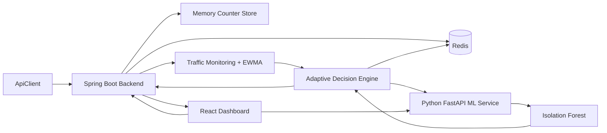
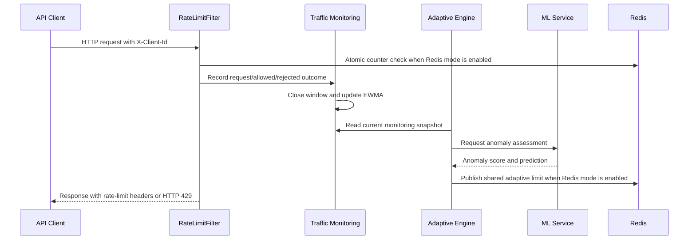

# AI-Driven Adaptive API Rate Limiter

**Final Year Project | B.Tech Computer Science and Engineering | Academic Session 2026–2027**

An adaptive API rate-limiting prototype that combines request enforcement, traffic monitoring, EWMA-based trend analysis, machine-learning-based anomaly assessment, and bounded adaptive limit decisions.

The project studies the trade-off between protecting API availability and avoiding unnecessary rejection of legitimate traffic. It is an implementation and evaluation project; it does not claim to invent rate limiting, EWMA, or Isolation Forest.

This README reflects the implementation and verification evidence available at the time of its latest update. Test counts are tied to their specific verification runs and must not be combined into a single claim.

---

## 1. Project Overview

Conventional API rate limiters enforce a predefined request quota within a time window. Fixed limits protect services from excessive traffic, but they do not automatically respond to changing traffic conditions.

This project integrates:

- **Java 17 and Spring Boot** for API request handling and rate-limit enforcement.
- **Fixed-window rate limiting** for the baseline request-control mechanism.
- **Traffic monitoring and EWMA** for observing and smoothing request-rate trends.
- **Python FastAPI** for exposing the machine-learning assessment service.
- **Isolation Forest** for identifying potentially unusual traffic patterns.
- **An adaptive decision engine** for making bounded runtime limit decisions.
- **A dynamic rate limiter** for applying updated limits to subsequent requests.
- **React + TypeScript + Vite** for the monitoring dashboard.
- **Redis** for shared counters, shared adaptive-limit state and leader coordination.

The current implementation has both in-memory and Redis-backed capabilities. They are verified under different conditions and are not interchangeable deployment modes.

## 2. Research Focus and Scope

### Research Question

Can traffic trend analysis and machine-learning-based anomaly assessment, combined with bounded adaptive rate-limit decisions, provide a useful alternative to conventional fixed-window rate limiting under controlled API traffic scenarios?

### Project Scope

The project focuses on integrating and evaluating:

1. API rate-limit enforcement.
2. EWMA-based traffic trend analysis.
3. Isolation Forest anomaly assessment.
4. Bounded adaptive decisions.
5. Static-versus-adaptive behaviour under controlled traffic scenarios.

The project also examines false positives, legitimate-request rejection, recovery behaviour, global adaptation and storage behaviour.

## 3. System Architecture and Execution Model

### 3.1 Component Flow



### 3.2 Request and Adaptation Flow



### 3.3 Dashboard Flow

The React dashboard is a presentation and monitoring layer. It consumes backend REST APIs and displays the state reported by the backend.

It does not independently calculate backend EWMA values, perform the Isolation Forest assessment, or enforce request limits.

### 3.4 Important Execution Detail

Request filtering is performed on the request path. Monitoring and adaptive evaluation run separately through the monitoring/scheduling workflow.

A newly applied limit affects subsequent requests; it does not retroactively change a request that has already been processed.

## 4. Technology Stack

| Layer | Technology |
|---|---|
| Backend | Java 17, Spring Boot 3.5.x |
| Build Tool | Maven |
| Baseline Rate Limiter | Fixed-window rate limiter |
| Adaptive Enforcement | Adaptive decision engine and dynamic rate limiter |
| Traffic Monitoring | Spring Boot monitoring components |
| Trend Analysis | Exponentially Weighted Moving Average (EWMA) |
| ML Service | Python, FastAPI, Pydantic |
| Anomaly Detection | Isolation Forest |
| Shared State / Coordination | Redis |
| Frontend | React, TypeScript, Vite |
| Backend Testing | JUnit, Spring Boot Test |
| ML Testing | pytest |
| Frontend Testing | Vitest, TypeScript typecheck, production build |

## 5. How the System Works

1. An API client sends a request to the Spring Boot application.
2. The rate-limit filter identifies the client and checks the active limit and counter.
3. An allowed request proceeds to the API endpoint. A rejected request receives HTTP `429 Too Many Requests`.
4. Request outcomes and traffic metrics are recorded.
5. Monitoring windows and EWMA provide traffic-trend information.
6. The Java feature mapper prepares traffic features for the ML service.
7. Spring Boot communicates with the Python FastAPI service.
8. Isolation Forest returns an anomaly assessment.
9. The adaptive decision engine evaluates the available trend and anomaly information using decision rules and configured bounds.
10. The adaptive limit advisor proposes a new limit, and the dynamic limiter applies it for subsequent requests.
11. The dashboard reads backend-reported metrics, history, decisions and system status.

**Important:** An anomaly assessment does not automatically mean that traffic is malicious. A legitimate traffic surge can also look unusual to an anomaly-detection model.

## 6. Components Implemented

### 6.1 Spring Boot Backend

- Static fixed-window request limiting with configurable limit and observation window.
- Client identification and request counting.
- HTTP `429` responses when the quota is exhausted.
- Rate-limit response headers: `X-RateLimit-Limit`, `X-RateLimit-Remaining`, `X-RateLimit-Reset` and `Retry-After`.
- Dynamic limit application for subsequent requests.
- Adaptive engine, advisor, properties and scheduled evaluation.
- Per-window request counts, current/average request rates, error rate and EWMA.
- Bounded in-memory traffic, anomaly, decision and limit history exposed through `/api/history`.
- Runtime system status through `/api/system-status`.
- Atomic Redis counters with Lua scripts, shared current-limit storage and a Redis leader lock.
- Configurable minimum/maximum adaptive limits, cooldown and confirmation windows.

### 6.2 Python ML Service

- Python FastAPI service on port `8000`.
- Request-schema validation.
- Isolation Forest anomaly assessment through `/detect`.
- Health and model metadata through `/health` and `/model/info`.
- Backend calls the ML service through `AnomalyServiceClient` and stores the latest assessment for the dashboard.
- ML availability and evaluation-status reporting through the backend.
- The current model is trained on synthetic data; real-world accuracy is not established.

### 6.3 React Monitoring Dashboard

The unified dashboard contains six pages:

| Page | Main Information |
|---|---|
| Overview | Current limit, mode, request metrics, traffic chart and recent history |
| Rate Limiting | Static/adaptive views, request tester and limit timeline |
| Traffic Monitoring | Traffic metrics, request/EWMA trends and monitoring-window history |
| Anomaly Detection | Latest ML assessment, anomaly history, model information and feature values |
| Adaptive Decisions | Decision history, limit timeline and decision/anomaly co-occurrence |
| System Status | Backend/API connectivity, storage state, scheduler status, ML availability and effective configuration |

The dashboard also supports:

- Time-range filtering.
- CSV exports.
- Empty-history states.
- Stale-data messaging.
- Backend-unavailable states.

The frontend uses actual backend responses rather than fabricated history data.

### 6.4 Evaluation Harness

`evaluation/` contains a deterministic synthetic trace replay framework that compares static and adaptive modes, polls `/api/adaptive/status`, computes metrics and can generate CSV/JSON/SVG artifacts locally.

Generated evaluation artifacts may be produced locally and are not committed with the implementation.

## 7. Traffic Monitoring and EWMA

The monitoring layer records request, allowed, rejected and traffic metrics across bounded monitoring windows. EWMA smooths the observed request rate so that adaptive decisions react to trends rather than a single noisy sample.

The EWMA recurrence used for verification is:

\[
EWMA_t = \alpha X_t + (1-\alpha)EWMA_{t-1}
\]

Where:

- \(X_t\) = current observation.
- \(\alpha\) = smoothing factor.
- \(EWMA_{t-1}\) = previous EWMA value.

EWMA gives greater importance to recent observations while retaining information from previous observations.

Live verification checked `119` consecutive history pairs with α = `0.3`. The maximum recurrence error was approximately `1.11 × 10⁻¹⁶`.

## 8. Adaptive Decision Mechanism

The adaptive decision engine combines traffic information and anomaly assessment with bounded decision rules.

Supported decision outcomes are:

- `INCREASE_LIMIT`
- `DECREASE_LIMIT`
- `KEEP_LIMIT`

Traffic spikes or unusual conditions may result in a conservative reduction. Normal conditions can support recovery, subject to configured bounds and cooldown behaviour. The implementation includes confirmation windows and never treats an increasing EWMA trend alone as proof of an attack.

The live verification run recorded `120` decisions: `4 DECREASE_LIMIT` and `116 KEEP_LIMIT`, with an observed limit path of `5→4→3→2→1`.

A decision is not proof that a traffic pattern is malicious. Decision/anomaly co-occurrence in the dashboard represents correlation across retained records, not proven causation.

The current adaptive limit is global rather than independently maintained for every client. This is a known design limitation.

## 9. Machine-Learning Component

The Python service exposes an Isolation Forest model through FastAPI.

### Traffic Features

| Feature | Meaning |
|---|---|
| `request_rate` | `request_count / interval_seconds`; requests per second |
| `error_rate` | `error_count / request_count`; `0.0` when there are no requests |
| `burst_ratio` | `current_rate / baseline_rate`; clamped for a zero baseline |
| `request_count` | Raw request count observed during the interval |

Reported model defaults are `200` estimators, `2000` synthetic training samples, contamination `0.05` and random state `42`. These are configuration details, not a claim of real-world accuracy.

### ML Service Endpoints

| Method | Endpoint | Purpose |
|---|---|---|
| GET | `/health` | Check ML service health |
| GET | `/model/info` | Retrieve model metadata |
| POST | `/detect` | Perform anomaly assessment |
| GET | `/docs` | Interactive API documentation |
| GET | `/openapi.json` | OpenAPI schema |

The latest backend feature vector was submitted to the ML detection endpoint during verification, and the returned score matched the corresponding backend history assessment for that window. Normal and extreme direct test inputs produced different assessments, and invalid payloads were rejected.

## 10. Redis Integration and Shared State

Redis is opt-in. The default `rate-limit.store=memory` preserves single-instance behaviour and requires no Redis.

When `rate-limit.store=redis`:

- Request counters are shared across application instances and incremented atomically with a Lua script (`INCR` + `PEXPIRE` on first increment).
- The current adaptive limit is shared, so limit changes made by the leader are observed by all instances.
- Adaptive evaluation is guarded by a Redis leader lock (`SET NX PX`). Only the lock holder evaluates and updates the limit.
- Metrics used for adaptive decisions are still collected per instance. The leader evaluates its own local monitoring snapshot; there is no cluster-wide metric aggregation.

Default keys (prefix `rl`):

| Key | Purpose |
|---|---|
| `rl:fw:{windowStartEpochMillis}:{clientId}` | Fixed-window request counter |
| `rl:limit:current` | Shared adaptive limit |
| `rl:adaptive:lock` | Adaptive-evaluation leader lock |

Configuration snippet:

```yaml
spring:
  data:
    redis:
      host: ${REDIS_HOST:localhost}
      port: ${REDIS_PORT:6379}
      timeout: 500ms
      connect-timeout: 500ms

rate-limit:
  store: memory            # memory (default) or redis
  redis:
    key-prefix: rl
    ttl-grace: 30s
    failure-mode: open     # open = local fallback; closed = reject while Redis is down
    failure-log-interval-seconds: 30

adaptive:
  enabled: false
  evaluation-lock-ttl-seconds: 60

dashboard-history:
  max-records: 120          # per traffic/anomaly/decision/limit series; memory only
```

Failure behaviour:

- `failure-mode=open` (default): Redis outages fall back to local counters and the last known adaptive limit; distributed guarantees do not apply while degraded.
- `failure-mode=closed`: requests are rejected while Redis is unavailable.
- If the leader lock is unavailable, adaptive evaluation is skipped for that cycle; request limiting continues normally.

**Important:** Dashboard history is bounded in-memory backend history, not durable Redis-backed history. It survives browser refresh while the backend is running, but resets when the backend restarts. Do not describe dashboard history as Redis-persistent.

## 11. API Endpoints

Check the current controller and DTO files for exact request and response fields. Do not assume undocumented endpoints or response schemas.

### Spring Boot Backend (`http://localhost:8080`)

| Method | Endpoint | Purpose |
|---|---|---|
| GET | `/api/health` | Backend health |
| GET | `/api/demo` | Demonstration endpoint used by the request tester |
| GET | `/api/metrics` | Traffic totals, rates, EWMA and window metrics |
| GET | `/api/adaptive/status` | Adaptive mode, current limit, anomaly assessment and decision counters |
| GET | `/api/system-status` | Backend, storage, monitoring, Redis and ML status |
| GET | `/api/history` | Bounded in-memory traffic, anomaly, decision and limit history |

### Python FastAPI Service (`http://localhost:8000`)

| Method | Endpoint | Purpose |
|---|---|---|
| GET | `/health` | ML service health |
| GET | `/model/info` | Model information |
| POST | `/detect` | Anomaly assessment |
| GET | `/docs` | Interactive API documentation |
| GET | `/openapi.json` | OpenAPI schema |

## 12. Project Directory Structure

```text
adaptive-rate-limiter/
├── src/
│   ├── main/
│   │   ├── java/com/example/ratelimiter/
│   │   │   ├── adaptive/           # Engine, advisor, provider and properties
│   │   │   ├── adaptive/client/    # ML service client and DTOs
│   │   │   ├── adaptive/integration/ # Scheduler and assessment mapping
│   │   │   ├── adaptive/lock/      # Leader-lock abstraction (Redis/no-op)
│   │   │   ├── adaptive/store/     # Shared adaptive-limit stores
│   │   │   ├── config/             # Configuration and properties
│   │   │   ├── controller/         # REST controllers
│   │   │   ├── history/            # Bounded dashboard history
│   │   │   ├── monitoring/         # Metrics, EWMA and monitoring service
│   │   │   ├── observability/      # System-status aggregation
│   │   │   ├── ratelimit/          # Filter, limiters and decisions
│   │   │   ├── ratelimit/store/    # Counter stores (memory/Redis)
│   │   │   └── AdaptiveRateLimiterApplication.java
│   │   └── resources/application.yml
│   └── test/                       # Java tests
├── ml-service/                     # FastAPI ML service and tests
├── frontend/                       # React + TypeScript dashboard and tests
├── evaluation/                     # Evaluation harness and tests
├── pom.xml, mvnw, mvnw.cmd
├── VERIFICATION.md
└── README.md
```

## 13. Current Implementation Status

| Area | Current Status | Evidence / Qualification |
|---|---|---|
| Spring Boot request handling and static rate limiter | Implemented and exercised | Live HTTP `200`/`429` request tests |
| Traffic monitoring and EWMA | Implemented and checked | `119` consecutive pairs; maximum recurrence error approximately `1.11 × 10⁻¹⁶` |
| Python FastAPI ML service | Implemented and exercised | Health, model information and detection endpoints checked |
| Isolation Forest assessment | Integrated and exercised | Backend feature vector assessment matched its corresponding backend history record |
| Adaptive decision engine and dynamic limit updates | Implemented and exercised | Live decision history and limit changes observed |
| React dashboard | Implemented | Six dashboard pages checked in browser automation |
| Dashboard history | Implemented using bounded in-memory backend storage | Survives browser refresh while backend runs; resets on backend restart |
| Redis-backed counter/state components | Implemented and locally tested | `26` focused local Redis tests passed; full Java suite also passed with local Redis |
| Local two-instance Redis demo | Completed | Shared counter and shared adaptive limit observed on local ports `8080` and `8081` |
| Docker/Testcontainers Redis verification | Not completed | Docker daemon was unavailable; Docker-based tests were skipped |
| Full production-style distributed deployment | Not demonstrated | Local Redis demo is not a full production deployment |
| Comparative evaluation | Harness exists and tests pass | Published synthetic artifacts predate safety corrections and have not been regenerated |

## 14. Testing and Verification

### 14.1 Test Commands

```powershell
# Java tests (Redis integration tests skip when Redis is unavailable)
.\mvnw.cmd clean test

# Java tests against a local Redis on port 6380
$env:REDIS_HOST='localhost'
$env:REDIS_PORT='6380'
.\mvnw.cmd test

# Python ML tests
cd ml-service
python -m pytest -q

# Frontend tests, typecheck and production build
cd frontend
npm test
npm run typecheck
npm run build

# Evaluation framework tests
.\ml-service\.venv\Scripts\python.exe -m pytest evaluation\tests -q
```

### 14.2 Latest Results — Release Validation, 2026-11-18

These are the latest runs. They supersede the earlier counts listed below.

| Scope | Result |
|---|---|
| Java full suite with local Redis on `6380` | `35 suites`, `187 tests`, `0 failures`, `0 errors`, `0 skipped` |
| Java full suite without Redis | `35 suites`, `187 tests`, `177 passed`, `0 failures`, `0 errors`, `10 skipped` |
| Focused Redis integration suite | `26 tests`, `0 failures`, `0 errors`, `0 skipped` |
| Python ML service | `76 passed`, `1 warning` |
| Frontend Vitest suite | `7 files`, `23 tests passed` |
| Frontend TypeScript typecheck | Passed |
| Frontend production build | Passed |
| Evaluation framework | `37 passed` |

The Java “without Redis” run discovered the same `187` tests as the Redis-enabled run; `10` Redis-dependent tests skipped because no Redis/Docker test environment was supplied. The Redis-enabled run executed all `187` tests.

### 14.3 Earlier Results — Retained for Traceability

| Scope | Result |
|---|---|
| Earlier Java full suite with local Redis | `144 passed`, `0 skipped`, `0 failures` |
| Earlier Java full suite without Redis | `134 passed`, `10 skipped`, `0 failures` |
| Earlier Redis-only tests | `10 passed`, `0 failures`, `0 errors` |
| Earlier Python ML service run | `76 passed` |
| Earlier evaluation framework run | `37 passed` |

Do not add earlier counts to the latest counts; they are separate runs from different project phases.

### 14.4 Live Functional Verification

The following were verified against running services:

- All services reachable: backend `8080`, frontend `5173`, ML `8000` → HTTP `200`.
- Six dashboard pages rendered: Overview, Rate Limiting, Traffic Monitoring, Anomaly Detection, Adaptive Decisions and System Status.
- Rate limiting: `5 allowed` at limit `5`, then HTTP `429`; a later run at adaptive limit `4` produced `4 allowed` then `429`.
- `Retry-After` and rate-limit headers were checked.
- A request-tester run observed an adaptive limit change while the run was in progress.
- EWMA: `119` consecutive pairs with α = `0.3`; maximum recurrence error `1.11022302462516E-16`.
- ML: `/detect` normal score `0.5633162533577502`, extreme anomaly score `0.82350943484316`, invalid payload HTTP `422`.
- The backend’s latest feature vector matched the corresponding direct `/detect` score with difference `0`.
- Adaptive decisions: `120` observations with `4 DECREASE_LIMIT` and `116 KEEP_LIMIT`; observed path `5→4→3→2→1`.
- CSV export: traffic, anomaly, decision and correlation CSVs with BOM, correct headers and `120` data rows each.
- Empty history after backend restart was displayed without fabricated records.
- Backend-offline and stale-data states were exercised.
- The dashboard recovered after the backend restarted.

These are observations from the reported verification runs, not universal performance guarantees.

See [`VERIFICATION.md`](VERIFICATION.md) for detailed Redis and release verification notes.

## 15. Redis Live Demo

A local Redis live demo was executed with two backend instances sharing one Redis prefix (`rl-demo-20261118`):

- Backend `8080` ran in Redis mode.
- A temporary second backend ran on `8081` with the same Redis host, port and key prefix.
- Both instances reported `store=REDIS`, `status=ready`, detail `Redis PING succeeded.` and fallback mode `OPEN`.
- With one client alternating requests between `8080` and `8081`, the fixed window produced `4 allowed` and `6 HTTP 429`, proving a shared counter.
- The adaptive limit changed from `5→4` during the burst because of `TRAFFIC_SPIKE`; this was expected behaviour.
- Both instances later reported the same current limit (`3`), proving shared adaptive-limit storage.
- Dashboard System Status showed `Redis store`, `Redis PING succeeded.` and `Store configuration REDIS`.

The temporary `8081` backend was stopped after the proof. This was a local two-instance demonstration; it is not a full production-style distributed deployment. No source or configuration files were changed by the live demo.

## 16. Known Limitations and Future Work

### Known Limitations

1. The Isolation Forest model uses synthetic training data; real-world accuracy is not established.
2. Adaptive limit changes are global, not independently maintained per client.
3. Dashboard history is bounded in-memory and resets on backend restart; it is not Redis-persistent.
4. Docker/Testcontainers Redis integration was not verified because the Docker daemon was unavailable.
5. A full production-style multi-instance distributed deployment was not demonstrated; only a local two-instance shared-state demo was performed.
6. Redis mode has no dedicated health endpoint; use `/api/system-status`.
7. Adaptive evaluation uses the leader instance’s local monitoring snapshot, not cluster-wide metric aggregation.
8. Time-range filtering controls and filtered CSV generation were checked, but actual row exclusion could not be demonstrated because the retained history span was shorter than the minimum five-minute filter.
9. When the backend is stopped, the Vite development proxy can return HTTP `500`, producing a less precise error message than a network-unreachable response.
10. `X-Client-Id` is not authenticated, and in-memory client state is not evicted.
11. Evaluation and ML data are synthetic/open-loop only, not production traffic or real incidents.
12. Earlier published synthetic results predate recent safety corrections and have not been regenerated.
13. Adaptive thresholds and step sizes require further experimental tuning.
14. Decision/anomaly co-occurrence does not establish causation.

### Future Work

- Complete Docker/Testcontainers Redis verification.
- Demonstrate a full production-style multi-instance deployment.
- Consider per-client adaptive limit management.
- Improve backend-unavailable error presentation.
- Use a suitable test configuration to verify longer time-range row exclusion.
- Re-run and publish comparative static-versus-adaptive evaluation results after final integration changes.
- Tune thresholds using repeatable experiments.
- Evaluate real-world or better-labelled traffic data.

## 17. Research Evaluation Plan

The project compares static and adaptive rate limiting under repeatable traffic scenarios.

### Traffic Scenarios

1. **Normal Traffic:** Regular request patterns.
2. **Sudden Traffic Spike:** Rapid increase in request volume.
3. **Error-Heavy Traffic:** Increased error rate.
4. **Recovery Phase:** Traffic returns towards normal after a burst or unusual period.

### Evaluation Metrics

- Legitimate-request rejection rate.
- Anomaly detection precision, recall and F1-score where labelled data is available.
- False-positive rate.
- Throughput.
- p50 and p95 response latency.
- Detection time.
- Adaptation time.
- Recovery behaviour.

Report measured results, test configuration, sample sizes and limitations.

Do not claim adaptive mode is superior unless the results support that conclusion. A lower request limit can reject legitimate traffic as well as anomalous traffic.

## 18. Running the Project Locally

### Prerequisites

- JDK 17.
- Maven Wrapper (`mvnw` / `mvnw.cmd`) included.
- Python version compatible with `ml-service/requirements.txt`.
- Node.js and npm for the React frontend.
- Git.
- Redis only when running the Redis-backed configuration.

Clone the repository:

```bash
git clone https://github.com/pragya638/adaptive-rate-limiter.git
cd adaptive-rate-limiter
```

### 18.1 Start the Spring Boot Backend

Windows:

```powershell
.\mvnw.cmd spring-boot:run
```

Linux/macOS:

```bash
./mvnw spring-boot:run
```

Default backend URL: `http://localhost:8080`.

To enable adaptive mode with the verification settings used in the live demo:

```powershell
.\mvnw.cmd spring-boot:run --args="--adaptive.enabled=true --monitoring.observation-interval=2s --adaptive.cooldown-seconds=0 --rate-limit.store=redis --spring.data.redis.host=localhost --spring.data.redis.port=6380"
```

### 18.2 Start the Python ML Service

Open another terminal:

```powershell
cd ml-service
python -m venv .venv
.\.venv\Scripts\Activate.ps1
python -m pip install -r requirements.txt
python -m uvicorn app.main:app --reload --port 8000
```

On Linux/macOS:

```bash
cd ml-service
python3 -m venv .venv
source .venv/bin/activate
python -m pip install -r requirements.txt
python -m uvicorn app.main:app --reload --port 8000
```

ML service URL: `http://localhost:8000`.

Interactive API documentation: `http://localhost:8000/docs`.

Set `ML_OBSERVATION_INTERVAL_SECONDS` to match the Spring Boot `monitoring.observation-interval` when intervals are changed.

### 18.3 Start the React Dashboard

Open another terminal:

```bash
cd frontend
npm ci
npm run dev
```

`npm install` also works if no lockfile-based install is desired.

The Vite development server commonly uses `http://localhost:5173`. Use the port printed by Vite if it selects a different one. The frontend expects backend APIs to be available through its configured API client/proxy.

### 18.4 Redis

For Redis-backed operation, start a Redis server and use the Redis connection settings configured by the application.

The verification used local Redis on `127.0.0.1:6380`; this is not necessarily the default port for every environment.

Starting Redis does not automatically switch the application from memory mode to Redis mode. Set `rate-limit.store=redis` explicitly.

## 19. Project Contribution

The project’s contribution is an integrated prototype and controlled evaluation of:

1. Conventional API rate-limit enforcement.
2. EWMA-based traffic trend analysis.
3. Isolation Forest anomaly assessment.
4. Bounded adaptive rate-limit decisions.
5. Dashboard visibility into traffic, anomaly assessments and decisions.
6. Comparison of static and adaptive behaviour under controlled scenarios.

The project also documents practical limitations such as false positives, legitimate-request rejection, recovery behaviour, global adaptation, bounded process-local history and non-durable Redis history claims.

## 20. Project Information

**Project Title:** AI-Driven Adaptive API Rate Limiter

**Repository:** https://github.com/pragya638/adaptive-rate-limiter

**Academic Programme:** B.Tech Computer Science and Engineering

**Academic Session:** 2026–2027

**Institution:** Raj Kumar Goel Institute of Technology, Ghaziabad
