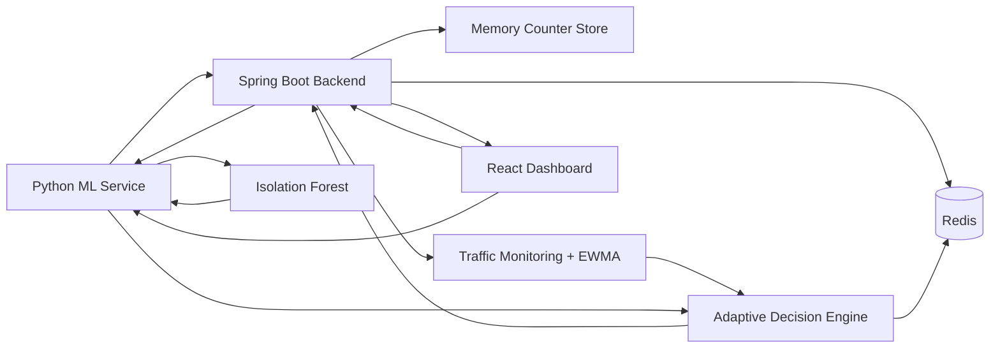
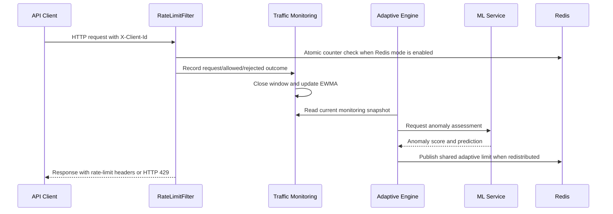

# AI-Driven Adaptive API Rate Limiter

A final-year project implementing an AI-driven adaptive API rate limiter using traffic trend analysis and anomaly detection.

This repository contains the completed implementation delivered so far:

- A Spring Boot backend with static rate limiting, adaptive rate limiting, traffic monitoring, EWMA trend analysis, bounded in-memory dashboard history, Redis-backed counters and shared adaptive-limit storage.
- A Python FastAPI machine-learning service using Isolation Forest for anomaly scoring.
- A React + TypeScript monitoring dashboard with six pages backed by real backend APIs.
- An evaluation harness for deterministic synthetic trace replay.
- Verification documentation, automated tests and Redis live-demo evidence summarized in this README.

The PR contains the implementation completed so far, not every possible future enhancement.

## Table of Contents

1. [Overview](#overview)
2. [Architecture](#architecture)
3. [Components Implemented](#components-implemented)
4. [Actual API Endpoints](#actual-api-endpoints)
5. [Request Processing Flow](#request-processing-flow)
6. [Project Directory Structure](#project-directory-structure)
7. [Prerequisites](#prerequisites)
8. [Installation and Setup](#installation-and-setup)
9. [Running the Services](#running-the-services)
10. [Redis Mode and Shared State](#redis-mode-and-shared-state)
11. [React Dashboard](#react-dashboard)
12. [Testing and Verification](#testing-and-verification)
13. [Redis Live Demo](#redis-live-demo)
14. [Current Limitations and Future Improvements](#current-limitations-and-future-improvements)
15. [Team Members](#team-members)

## Overview

The system combines four ideas:

1. **Static API rate limiting** enforces a fixed request limit per client in a fixed window.
2. **Traffic monitoring** records request rates and computes an EWMA trend.
3. **Anomaly detection** uses a Python Isolation Forest model to score recent traffic behavior.
4. **Adaptive rate limiting** changes the effective limit based on monitored traffic and anomaly assessments, while preserving safety bounds.

Redis is opt-in and enables request counters and the current adaptive limit to be shared by multiple backend instances. The dashboard history remains bounded in memory; it is not a durable Redis-backed history store.

## Architecture





## Components Implemented

### Spring Boot Backend

- **Static rate limiting:** fixed-window limiter with `X-RateLimit-Limit`, `X-RateLimit-Remaining`, `X-RateLimit-Reset`, and `Retry-After` headers; HTTP `429` when the limit is exhausted.
- **Adaptive rate limiting:** adaptive engine, advisor, properties and scheduled evaluation.
- **Traffic monitoring:** per-window request counts, current/average request rates, error rate and EWMA.
- **Dashboard history:** bounded in-memory traffic, anomaly, decision and limit series exposed through `/api/history`.
- **System status:** `GET /api/system-status` reports backend health, ML health, Redis store status and effective configuration.
- **Redis integration:** atomic counters with Lua scripts, shared current-limit storage and a Redis leader lock for adaptive evaluation.
- **Safety bounds:** configurable minimum/maximum adaptive limits, cooldown and confirmation windows. Adaptive evaluation never relies on an increasing EWMA trend alone.

### Python ML Service

- FastAPI service on port `8000`.
- Isolation Forest scoring through `/detect`.
- Health and model metadata through `/health` and `/model/info`.
- Backend calls the ML service through `AnomalyServiceClient` and stores the latest assessment for the dashboard.
- The model is trained on synthetic data; it is not a production-trained detector.

### React Dashboard

React + TypeScript + Vite dashboard on port `5173` with six pages:

| Page | Purpose |
|------|---------|
| Overview | Current limit, mode, traffic totals and service health |
| Rate Limiting | Static/adaptive configuration and interactive request tester |
| Traffic Monitoring | Request-rate chart, EWMA and window metrics |
| Anomaly Detection | ML health, anomaly score, prediction and history |
| Adaptive Decisions | Recent decisions with action, reason and before/after limits |
| System Status | Backend, ML and Redis/store status with effective configuration |

The dashboard consumes real backend APIs. It does not rely on permanent mock data.

### Evaluation Harness

`evaluation/` contains a deterministic synthetic trace replay framework that compares static and adaptive modes, polls `/api/adaptive/status`, computes metrics and can generate CSV/JSON/SVG artifacts locally. Generated result artifacts are not committed in this PR.

## Actual API Endpoints

### Backend (`http://localhost:8080`)

| Endpoint | Purpose |
|----------|---------|
| `GET /api/health` | Backend health probe |
| `GET /api/metrics` | Traffic totals, rates, EWMA and window metrics |
| `GET /api/adaptive/status` | Adaptive mode, current limit, latest anomaly assessment and decision counters |
| `GET /api/system-status` | Backend/ML health, Redis store status and effective configuration |
| `GET /api/history` | Bounded in-memory traffic, anomaly, decision and limit history |
| `GET /api/demo` | Demo endpoint used by the dashboard request tester |

### ML Service (`http://localhost:8000`)

| Endpoint | Purpose |
|----------|---------|
| `GET /health` | ML service health |
| `GET /model/info` | Model name/version and feature metadata |
| `POST /detect` | Anomaly score and prediction for one feature vector |
| `GET /docs` | FastAPI Swagger UI |
| `GET /openapi.json` | OpenAPI schema |

## Request Processing Flow

1. A request reaches `RateLimitFilter` with an `X-Client-Id` header.
2. The limiter checks the fixed-window counter in memory or Redis.
3. `TrafficMetrics` records request and outcome counts.
4. The monitoring service closes windows and updates the EWMA trend.
5. The adaptive engine periodically reads the latest snapshot and requests an anomaly assessment from the ML service.
6. If adaptation is enabled and safety/confirmation rules pass, the engine updates the limit and records a decision.
7. The filter emits rate-limit headers or returns HTTP `429`.
8. The dashboard reads `/api/metrics`, `/api/adaptive/status`, `/api/history` and `/api/system-status` for visualization.

## Project Directory Structure

```text
adaptive-rate-limiter/
├── src/
│   ├── main/
│   │   ├── java/com/example/ratelimiter/
│   │   │   ├── adaptive/           # Engine, advisor, provider and properties
│   │   │   ├── adaptive/client/    # ML service client and DTOs
│   │   │   ├── adaptive/integration/ # Scheduler and assessment mapping
│   │   │   ├── adaptive/lock/      # Leader-lock abstraction (Redis/no-op)
│   │   │   ├── adaptive/store/     # Shared adaptive-limit stores
│   │   │   ├── config/             # Configuration and properties
│   │   │   ├── controller/         # REST controllers
│   │   │   ├── history/            # Bounded dashboard history
│   │   │   ├── monitoring/         # Metrics, EWMA and monitoring service
│   │   │   ├── ratelimit/          # Filter, limiters and decisions
│   │   │   ├── ratelimit/store/    # Counter stores (memory/Redis)
│   │   │   └── AdaptiveRateLimiterApplication.java
│   │   └── resources/application.yml
│   └── test/                       # Java tests
├── ml-service/                     # FastAPI ML service and tests
├── frontend/                       # React + TypeScript dashboard and tests
├── evaluation/                     # Evaluation harness and tests
├── pom.xml, mvnw, mvnw.cmd
├── VERIFICATION.md
└── README.md
```

## Prerequisites

- **Java:** JDK 17+
- **Maven:** Maven Wrapper (`mvnw` / `mvnw.cmd`) included
- **Python:** Python 3 with `pip` and `venv`
- **Node.js/npm:** required for the React dashboard
- **Redis:** optional; required only for Redis mode or Redis integration tests

## Installation and Setup

```bash
git clone https://github.com/pragya638/adaptive-rate-limiter.git
cd adaptive-rate-limiter
```

## Running the Services

### Spring Boot Backend

Windows (PowerShell):

```powershell
.\mvnw.cmd spring-boot:run
```

macOS/Linux:

```bash
./mvnw spring-boot:run
```

Default: `http://localhost:8080`. Adaptive mode is disabled by default.

To enable adaptive mode with the verification settings used in the live demo:

```powershell
.\mvnw.cmd spring-boot:run --args="--adaptive.enabled=true --monitoring.observation-interval=2s --adaptive.cooldown-seconds=0 --rate-limit.store=redis --spring.data.redis.host=localhost --spring.data.redis.port=6380"
```

### Python ML Service

Windows (PowerShell):

```powershell
cd ml-service
python -m venv .venv
.\.venv\Scripts\Activate.ps1
python -m pip install -r requirements.txt
python -m uvicorn app.main:app --reload --port 8000
```

macOS/Linux:

```bash
cd ml-service
python3 -m venv .venv
source .venv/bin/activate
python -m pip install -r requirements.txt
python -m uvicorn app.main:app --reload --port 8000
```

Set `ML_OBSERVATION_INTERVAL_SECONDS` to match `monitoring.observation-interval` when aligning intervals in experiments.

### React Dashboard

```powershell
cd frontend
npm ci
npm run dev
```

Default: `http://localhost:5173`. The Vite dev server proxies backend calls to `http://localhost:8080`.

## Redis Mode and Shared State

Redis is opt-in. The default `rate-limit.store=memory` preserves single-instance behavior and requires no Redis.

When `rate-limit.store=redis`:

- Request counters are shared across application instances and incremented atomically with a Lua script (`INCR` + `PEXPIRE` on first increment).
- The current adaptive limit is shared, so limit changes made by the leader are observed by all instances.
- Adaptive evaluation is guarded by a Redis leader lock (`SET NX PX`). Only the lock holder evaluates and updates the limit.
- Metrics used for adaptive decisions are still collected per instance. The leader evaluates its own local monitoring snapshot; there is no cluster-wide metric aggregation.

Default keys (prefix `rl`):

| Key | Purpose |
|-----|---------|
| `rl:fw:{windowStartEpochMillis}:{clientId}` | Fixed-window request counter |
| `rl:limit:current` | Shared adaptive limit |
| `rl:adaptive:lock` | Adaptive-evaluation leader lock |

Configuration snippet:

```yaml
spring:
  data:
    redis:
      host: ${REDIS_HOST:localhost}
      port: ${REDIS_PORT:6379}
      timeout: 500ms
      connect-timeout: 500ms

rate-limit:
  store: memory            # memory (default) or redis
  redis:
    key-prefix: rl
    ttl-grace: 30s
    failure-mode: open     # open = local fallback; closed = reject while Redis is down
    failure-log-interval-seconds: 30

adaptive:
  enabled: false
  evaluation-lock-ttl-seconds: 60

dashboard-history:
  max-records: 120          # per traffic/anomaly/decision/limit series; memory only
```

Start Redis and run the backend with Redis enabled:

```powershell
docker run --rm --name rate-limit-redis -p 6379:6379 redis:7-alpine
$env:RATE_LIMIT_STORE='redis'
$env:ADAPTIVE_ENABLED='true'
.\mvnw.cmd spring-boot:run
```

`RATE_LIMIT_STORE`, `REDIS_HOST`, `REDIS_PORT`, and `ADAPTIVE_ENABLED` use Spring relaxed binding.

Failure behavior:

- `failure-mode=open` (default): Redis outages fall back to local counters and the last known adaptive limit; distributed guarantees do not apply while degraded.
- `failure-mode=closed`: requests are rejected while Redis is unavailable.
- If the leader lock is unavailable, adaptive evaluation is skipped for that cycle; request limiting continues normally.

## Testing and Verification

### Commands

```powershell
# Java tests (Redis integration tests skip when Redis is unavailable)
.\mvnw.cmd clean test

# Java tests against a local Redis on port 6380
$env:REDIS_HOST='localhost'
$env:REDIS_PORT='6380'
.\mvnw.cmd test

# Python ML tests
cd ml-service
python -m pytest -q

# Frontend tests, typecheck and production build
cd frontend
npm test
npm run typecheck
npm run build

# Evaluation framework tests
.\ml-service\.venv\Scripts\python.exe -m pytest evaluation\tests -q
```

### Latest Results (release validation, 2026-11-18)

These are the latest runs for this PR. They supersede the earlier counts listed below.

| Scope | Result |
|-------|--------|
| Java full suite with local Redis on `6380` | `35 suites`, `187 tests`, `0 failures`, `0 errors`, `0 skipped` |
| Java full suite without Redis | `35 suites`, `187 tests`, `177 passed`, `0 failures`, `0 errors`, `10 skipped` |
| Focused Redis integration suite | `26 tests`, `0 failures`, `0 errors`, `0 skipped` |
| Python ML service | `76 passed`, `1 warning` |
| Frontend Vitest suite | `7 files`, `23 tests passed` |
| Frontend TypeScript typecheck | Passed |
| Frontend production build | Passed |
| Evaluation framework | `37 passed` |

The Java “without Redis” run discovered the same `187` tests; `10` Redis-dependent tests skipped because no local Redis/Docker was supplied. The “with Redis” run executed those tests and reported `187 passed, 0 skipped`. Focused Redis reruns reported `26 passed`.

### Earlier Results (Phase 4A/Phase 5 verification, retained for traceability)

| Scope | Result |
|-------|--------|
| Java full suite with local Redis | `144 passed`, `0 skipped`, `0 failures` |
| Java full suite without Redis | `134 passed`, `10 skipped`, `0 failures` |
| Redis-only tests | `10 passed`, `0 failures`, `0 errors` |
| Python ML service | `76 passed` |
| Evaluation framework | `37 passed` |

Do not add these earlier counts to the latest counts; they are separate runs from earlier project phases.

### Live Functional Verification (Phase 4B)

The following were verified against running services:

- All services reachable: backend `8080`, frontend `5173`, ML `8000`.
- Six dashboard pages rendered: Overview, Rate Limiting, Traffic Monitoring, Anomaly Detection, Adaptive Decisions, System Status.
- Rate limiting: `5 allowed` at limit `5`, then HTTP `429`; a later run at adaptive limit `4` produced `4 allowed` then `429`.
- EWMA: `119` consecutive pairs, α=`0.3`, maximum recurrence error `1.11022302462516E-16`.
- ML: `/detect` normal score `0.5633162533577502`, extreme anomaly score `0.82350943484316`, invalid payload HTTP `422`.
- Adaptive decisions: `120` observations with `4 DECREASE_LIMIT` and `116 KEEP_LIMIT`; an observed path `5→4→3→2→1`.
- CSV export: traffic, anomaly, decision and correlation CSVs with BOM, correct headers and `120` data rows each.

See [`VERIFICATION.md`](VERIFICATION.md) for detailed Redis verification notes and environment information.

## Redis Live Demo

A Redis live demo was executed with two backend instances sharing one Redis prefix (`rl-demo-20261118`):

- Backend `8080` ran in Redis mode.
- A temporary second backend ran on `8081` with the same Redis host, port and key prefix.
- Both instances reported `store=REDIS`, `status=ready`, detail `Redis PING succeeded.` and fallback mode `OPEN`.
- With one client alternating requests between `8080` and `8081`, the fixed window produced `4 allowed` and `6 HTTP 429`, proving a shared counter.
- The adaptive limit changed from `5→4` during the burst because of `TRAFFIC_SPIKE`; this was expected behavior.
- Both instances later reported the same current limit (`3`), proving shared adaptive-limit storage.
- Dashboard System Status showed `Redis store`, `Redis PING succeeded.` and `Store configuration REDIS`.

The temporary `8081` backend was stopped after the proof. No source or configuration files were changed by the live demo.

## Current Limitations and Future Improvements

- **Dashboard history:** bounded in-memory history resets on backend restart. It is not durable Redis-backed history.
- **Redis:** Docker/Testcontainers verification was not run in this environment because the Docker daemon was unavailable; local Redis `6380` was used instead.
- **Redis health:** there is no dedicated Redis health endpoint; `GET /api/system-status` reports store status.
- **Cluster metrics:** adaptive evaluation uses the leader instance's local monitoring snapshot, not cluster-wide aggregation.
- **Time-range filtering:** with `monitoring.observation-interval=2s` and `dashboard-history.max-records=120`, retained history spans about four minutes, so a minimum five-minute filter cannot exclude older rows in this configuration.
- **Vite proxy errors:** when the backend is stopped behind the dev proxy, HTTP `500` may appear instead of a precise network-unreachable message.
- **Client identity:** `X-Client-Id` is unauthenticated and can be spoofed.
- **Client-state eviction:** in-memory client maps and rejected-state entries are not evicted, so unbounded unique client IDs can grow memory.
- **ML model:** trained on synthetic data; false positives are possible.
- **Evaluation scope:** synthetic/open-loop traces only, not production traffic or real incidents.
- **Adaptive behavior:** earlier published synthetic results predate several safety corrections and have not been regenerated in this PR.

## Team Members

*To be added as per project requirements.*
