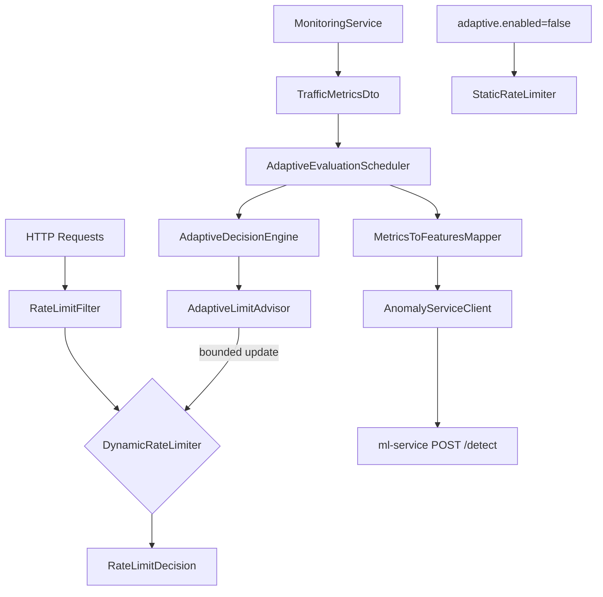

# Adaptive API Rate Limiter (AI-Driven)

**Final Year Project:** AI-Driven Adaptive API Rate Limiting Using Traffic Trend Analysis and Anomaly Detection

An intelligent API rate-limiting system designed to monitor traffic patterns, detect unusual request behaviour, and eventually adjust request limits dynamically while protecting API availability.

The repository currently includes a Spring Boot static rate limiter (Phase 1), traffic monitoring with Exponentially Weighted Moving Average (EWMA) trend analysis (Phase 3), and a standalone Python FastAPI Isolation Forest anomaly detection service (Phase 4).

**The complete adaptive system is still under development.** The current implementation status and remaining work are documented below.

## Table of Contents

- [Problem Statement and Motivation](#problem-statement-and-motivation)
- [Project Objectives](#project-objectives)
- [Key Features](#key-features)
- [Technology Stack](#technology-stack)
- [High-Level Architecture](#high-level-architecture)
- [Implementation Status](#implementation-status)
- [Phase 1: Spring Boot Static Rate Limiter](#phase-1-spring-boot-static-rate-limiter)
- [Phase 3: Traffic Monitoring and EWMA](#phase-3-traffic-monitoring-and-ewma)
- [Phase 4: Isolation Forest Anomaly Detection Service](#phase-4-isolation-forest-anomaly-detection-service)
- [Phase 5: Adaptive Decision Engine and Integration](#phase-5-adaptive-decision-engine-and-integration)
- [Repository Structure](#repository-structure)
- [Prerequisites](#prerequisites)
- [Repository Setup and Quick Start](#repository-setup-and-quick-start)
- [Running Tests](#running-tests)
- [Service URLs](#service-urls)
- [Example API Calls](#example-api-calls)
- [Current Limitations](#current-limitations)
- [Future Work](#future-work)

## Problem Statement and Motivation

Traditional API rate limiters generally enforce predefined request limits over a specified time window. Although effective at controlling request volume, a fixed limit may not respond well to changing traffic patterns or unusual request behaviour.

For example, a sudden increase in requests may be legitimate during peak usage or may indicate automated abuse. A fixed threshold alone cannot distinguish these situations.

This project explores combining conventional rate limiting, traffic trend analysis, and machine-learning-based anomaly detection to support more context-aware rate-limit decisions.

## Project Objectives

- Protect APIs against excessive request traffic.
- Enforce configurable request limits for individual clients.
- Collect traffic metrics, including total, allowed, and rate-limited requests.
- Analyse request-rate trends using EWMA.
- Detect potentially anomalous traffic using an Isolation Forest model.
- Integrate monitoring and anomaly scores into an adaptive decision engine.
- Evaluate static and adaptive approaches using controlled traffic experiments.
- Maintain safety bounds so that adaptation does not unnecessarily block legitimate traffic.

## Key Features

### Implemented

- Spring Boot REST API with a static fixed-window rate limiter.
- Configurable request limits and window duration.
- HTTP 429 responses when a client exceeds its configured limit.
- Rate-limit response headers.
- Traffic metrics collection and EWMA-based trend analysis.
- Python FastAPI service for Isolation Forest anomaly detection.
- Input validation, including rejection of non-finite numeric values.
- Automated tests for the Spring Boot and Python services.
- Separate service code and documentation.
- Phase 5 adaptive decision engine with thread-safe dynamic limits, scheduled evaluation, ML-backed anomaly assessment, and conservative fallback.

### Planned or still in progress

- Redis-backed rate-limit state.
- React monitoring dashboard.
- Live end-to-end validation against a running ML service.
- End-to-end evaluation of the complete adaptive system.

## Technology Stack

| Component | Technology |
|---|---|
| Backend API | Java 17, Spring Boot 3.5.x |
| Build tool | Maven Wrapper |
| Traffic monitoring | Spring Boot metrics components |
| Trend analysis | EWMA |
| Anomaly detection | Python, FastAPI, Isolation Forest |
| Validation and API schemas | Pydantic |
| Automated testing | JUnit, Spring Boot Test, pytest |
| Future shared rate-limit state | Redis — planned |
| Future monitoring interface | React — planned |

Exact dependency versions are defined in `pom.xml` and `ml-service/requirements.txt`.

## High-Level Architecture

The intended system consists of the following components:

1. **Spring Boot API:** receives requests and enforces either the static or dynamic fixed-window rate limiter.
2. **Traffic monitoring:** records request activity and calculates traffic-rate metrics and EWMA trends.
3. **Isolation Forest service:** analyses supplied traffic features and returns an anomaly assessment.
4. **Adaptive decision engine:** combines traffic metrics and anomaly assessments to adjust limits within configured safety bounds when adaptive mode is enabled.
5. **Redis integration — planned:** supports shared rate-limit state across backend instances.
6. **React dashboard — planned:** displays traffic metrics, rate-limit activity, and anomaly information.

The Spring Boot adaptive loop is implemented. Redis-backed state, dashboard support, and live ML validation remain pending.

## Implementation Status

| Phase | Component | Status |
|---|---|---|
| Phase 1 | Spring Boot static rate limiter | Implemented and tested |
| Phase 2 | Redis integration | Pending |
| Phase 3 | Traffic monitoring and EWMA | Implemented and tested |
| Phase 4 | Python FastAPI Isolation Forest service | Implemented and tested independently |
| Phase 5 | Adaptive decision engine and service integration | Implemented; live ML validation pending |
| Phase 6 | React dashboard | Pending |
| Phase 7 | End-to-end experiments and comparative evaluation | Pending |

This table describes the current known project status. Update it whenever a phase is completed and verified.

## Phase 1: Spring Boot Static Rate Limiter

The backend implements a fixed-window rate-limiting mechanism.

### Main capabilities

- Configurable maximum requests per client within a time window.
- Client identification using the `X-Client-Id` header, with an IP-based fallback.
- HTTP 429 response when the configured request limit is exceeded.
- Rate-limit headers that communicate the limit and remaining quota.
- Separation of rate-limiting logic from controller logic.

### Endpoints

| Method | Endpoint | Purpose |
|---|---|---|
| GET | `/api/health` | Health check; excluded from rate limiting |
| GET | `/api/demo` | Demonstration endpoint protected by the limiter |

The default configuration previously verified for Phase 1 allows five requests per client within a 30-second window. Confirm the current values in `src/main/resources/application.yml` before changing or documenting them.

## Phase 3: Traffic Monitoring and EWMA

This phase adds traffic metrics and trend analysis to the Spring Boot application.

### Main capabilities

- Collection of total request counts.
- Tracking of allowed and rate-limited requests.
- Monitoring of request rates and error-related metrics.
- EWMA-based traffic-rate smoothing.
- Configurable EWMA alpha and observation interval.
- A metrics endpoint for retrieving monitoring data.

### Configuration

The previously reported configuration includes:

```yaml
monitoring:
  ewma-alpha: 0.3
  observation-interval: 30s
```

The EWMA smoothing factor must satisfy:

`0 < alpha <= 1`

A lower alpha generally smooths short-term changes more strongly, while a higher alpha responds more quickly to recent observations.

### Metrics endpoint

The implementation report identifies `/api/metrics` as the metrics endpoint. Check the current controller and DTO for the exact response schema before integrating a dashboard or another service.

EWMA monitoring provides a smoothed traffic trend. It does not, by itself, implement adaptive rate-limit decisions.

## Phase 4: Isolation Forest Anomaly Detection Service

The `ml-service/` directory contains a standalone Python FastAPI service for anomaly detection.

### Main capabilities

- Isolation Forest-based anomaly assessment.
- Request schema validation.
- Rejection of invalid, non-finite numeric inputs such as NaN and Infinity.
- Health and model-information endpoints.
- Detection endpoint.
- Automated API and detector tests.
- API documentation through FastAPI.

### Service endpoints

| Method | Endpoint | Purpose |
|---|---|---|
| GET | `/health` | Service health check |
| GET | `/model/info` | Model information and readiness details |
| POST | `/detect` | Submit traffic features for anomaly detection |
| GET | `/docs` | Interactive API documentation |
| GET | `/openapi.json` | OpenAPI schema |

These routes belong to the Python service and are separate from the Spring Boot API routes.

### Model limitations

The current model uses synthetic training data. Although automated tests and endpoint checks have passed, real-world anomaly detection performance has not yet been established.

Precision, recall, F1-score, false-positive rate, and detection latency must be evaluated using suitable labelled or controlled test data before drawing conclusions about model quality.

The Spring Boot adaptive scheduler calls the anomaly detection service through `AnomalyServiceClient` when adaptive mode is enabled. Live validation against a running service is still pending.

## Phase 5: Adaptive Decision Engine and Integration

### Overview

Phase 5 implements the adaptive loop: a thread-safe dynamic rate limiter, a decision engine with safety bounds, an advisor that applies decisions, a background scheduler that evaluates traffic metrics, and an ML-backed anomaly assessment provider with conservative fallback.

### Current behaviour and configuration

- `adaptive.enabled=false` (default): the existing static fixed-window rate limiter remains active. Request handling uses `rate-limit.max-requests` and `rate-limit.window`, and no adaptive scheduler or advisor is created.
- `adaptive.enabled=true`: the dynamic rate limiter is active. It starts at `adaptive-rate-limiter.initial-limit`, clamped to `min-limit`/`max-limit`, and the background scheduler periodically evaluates traffic metrics and applies bounded limit updates.
- `adaptive.evaluation-interval-seconds` controls how often the background evaluation runs. `adaptive.cooldown-seconds` limits how frequently limit updates may be applied.
- `adaptive-rate-limiter.*` controls the decision engine and dynamic limiter bounds and thresholds.
- `ml-service.*` controls the HTTP client used to call the Python anomaly detection service, including connect and read timeouts.

### Architecture (Mermaid)



### Implemented components

- `DynamicRateLimiter`: fixed-window limiter with an atomic, runtime-adjustable limit. Updates are clamped to configured minimum and maximum bounds.
- `AdaptiveDecisionEngine`, `DecisionAction`, `AdaptiveDecision`, `TrafficAssessment`, `AnomalyAssessment`.
- `AdaptiveLimitAdvisor`: synchronously applies engine decisions, enforces the update cooldown, and relies on the limiter for final bound enforcement.
- `AdaptiveEvaluationScheduler`: scheduled background evaluation using `MonitoringService` metrics.
- `HttpAnomalyAssessmentProvider` and `AnomalyAssessmentProvider`: convert ML responses using `AnomalyServiceClient` and `MetricsToFeaturesMapper`.
- `AdaptiveEngineProperties`, `AdaptiveIntegrationProperties`, and `MlServiceProperties`.
- Conditional wiring in `RateLimitConfiguration`: static limiter when adaptive mode is disabled, dynamic limiter when enabled.

### Configuration (application.yml)

```yaml
ml-service:
  base-url: http://localhost:8000
  connect-timeout-ms: 1000
  read-timeout-ms: 1000

adaptive:
  enabled: false
  evaluation-interval-seconds: 30
  cooldown-seconds: 10

adaptive-rate-limiter:
  min-limit: 1
  max-limit: 1000
  initial-limit: 5
  increase-step: 10
  decrease-step: 10
```

### Safety and Fallbacks

- The decision engine clamps proposed limits to the configured `min-limit` and `max-limit` bounds, and `DynamicRateLimiter` independently clamps every update.
- When the ML service is unreachable, times out, returns a non-2xx response, or returns an invalid payload, the provider returns an unavailable assessment and the engine uses its conservative fallback (no limit increase).
- The scheduler runs in the background, catches runtime failures, and never blocks the request path.
- `adaptive.enabled=false` preserves the existing static limiter configuration and behaviour.

### Testing

- Unit and integration tests cover the dynamic limiter, advisor, scheduler, ML provider fallback, and both enabled and disabled application modes.
- The full Spring Boot suite currently passes 62 tests.
- Tests use mocked ML responses or a deliberately unavailable local endpoint. Live end-to-end validation against a running `ml-service` has not been performed.

### Remaining Limitations (Phase 5)

- The ML-backed adaptive loop has not been validated against a live running `ml-service`; default tests exercise mocked or unavailable responses.
- The anomaly detection model uses synthetic training data, so real-world detection quality is not established.
- Limits and counters are process-local and in-memory; Redis-backed shared state remains pending.
- Adaptive thresholds and step sizes require tuning and evaluation with controlled traffic experiments.

## Repository Structure

The main repository is organised into the Spring Boot backend and the standalone Python service.

```text
adaptive-rate-limiter/
├── src/
│   ├── main/
│   │   ├── java/com/example/ratelimiter/
│   │   └── resources/
│   └── test/
├── ml-service/
│   ├── app/
│   │   ├── config.py
│   │   ├── detector.py
│   │   ├── main.py
│   │   └── schemas.py
│   ├── tests/
│   ├── requirements.txt
│   ├── pytest.ini
│   └── README.md
├── pom.xml
├── mvnw
├── mvnw.cmd
├── .mvn/
└── README.md
```

This is a representative structure. Refer to the actual repository for any additional files or directories.

## Prerequisites

### Spring Boot backend

- JDK 17 or a compatible configured Java installation.
- Git.
- No separate Maven installation is required when using the included Maven Wrapper.

Check Java:

```powershell
java -version
```

### Python anomaly detection service

- Python version compatible with `ml-service/requirements.txt`.
- pip.

The service has previously been tested in a Python 3.14.2 environment. If a dependency does not support your local Python version, use a compatible Python release and verify the dependency file before proceeding.

## Repository Setup and Quick Start

Clone the repository:

```bash
git clone https://github.com/pragya638/adaptive-rate-limiter.git
cd adaptive-rate-limiter
```

### Run the Spring Boot backend

On Windows PowerShell:

```powershell
.\mvnw.cmd spring-boot:run
```

On macOS or Linux:

```bash
./mvnw spring-boot:run
```

The backend uses port `8080` by default, unless configured otherwise.

### Run the Python anomaly detection service

Open a separate terminal at the repository root.

On Windows PowerShell:

```powershell
cd ml-service
python -m venv .venv
.\.venv\Scripts\Activate.ps1
python -m pip install -r requirements.txt
python -m uvicorn app.main:app --reload --port 8000
```

On macOS or Linux:

```bash
cd ml-service
python3 -m venv .venv
source .venv/bin/activate
python -m pip install -r requirements.txt
python -m uvicorn app.main:app --reload --port 8000
```

If your environment uses a different compatible Python executable, substitute it for `python` or `python3`.

The commands assume that the FastAPI application exposes an ASGI object named `app` in `app/main.py`. Check `ml-service/README.md` if the startup command has changed.

## Running Tests

### Spring Boot tests

Run from the repository root:

```powershell
.\mvnw.cmd clean test
```

Or on macOS/Linux:

```bash
./mvnw clean test
```

The current Spring Boot suite (Phases 1, 3, and 5) completes 62 tests with no failures or errors. Re-run the tests after pulling new changes to confirm the current state.

### Python service tests

Run from the repository root:

```powershell
cd ml-service
python -m pytest
```

The latest reported Phase 4 verification completed 68 tests successfully. Re-run the tests after making changes to confirm the current state.

### Dependency validation

From `ml-service/`, run:

```powershell
python -m pip check
```

## Service URLs

When both services are running locally with the default ports:

| Service | URL |
|---|---|
| Spring Boot API | `http://localhost:8080` |
| Spring Boot health endpoint | `http://localhost:8080/api/health` |
| Spring Boot demo endpoint | `http://localhost:8080/api/demo` |
| Spring Boot metrics endpoint | `http://localhost:8080/api/metrics` |
| Python FastAPI service | `http://localhost:8000` |
| Python health endpoint | `http://localhost:8000/health` |
| Python model information | `http://localhost:8000/model/info` |
| Python API documentation | `http://localhost:8000/docs` |

These are local development URLs. They assume the default ports and route configuration.

## Example API Calls

### Spring Boot health check

```powershell
curl.exe -i http://localhost:8080/api/health
```

### Spring Boot protected endpoint

```powershell
curl.exe -i -H "X-Client-Id: demo-user" http://localhost:8080/api/demo
```

Repeat the request within the configured time window to observe rate-limit headers and, after the quota is exhausted, an HTTP 429 response.

### View Spring Boot metrics

```powershell
curl.exe -i http://localhost:8080/api/metrics
```

Inspect the actual response body to see the metrics fields currently exposed by the application.

### Python service health check

```powershell
curl.exe -i http://localhost:8000/health
```

### Python model information

```powershell
curl.exe -i http://localhost:8000/model/info
```

### Python anomaly detection

The exact JSON request schema is defined in `ml-service/app/schemas.py`. Consult `http://localhost:8000/docs` for the current required fields and request example before sending a detection request.

## Current Limitations

- Redis-backed shared rate-limit state is pending.
- Adaptive limits and counters are process-local and in-memory.
- Live end-to-end validation against a running Python ML service has not been performed.
- The anomaly detection model uses synthetic training data.
- Real-world model accuracy has not yet been evaluated.
- Adaptive thresholds and step sizes still require tuning with controlled traffic experiments.
- The React dashboard has not yet been implemented.
- End-to-end performance comparisons between static and adaptive approaches are pending.

## Future Work

1. Integrate Redis for shared rate-limit state.
2. Validate the Spring Boot adaptive loop end to end against a running Python anomaly detection service.
3. Tune adaptive thresholds and step sizes using controlled traffic scenarios.
4. Harden and tune the existing minimum and maximum rate-limit bounds for production traffic.
5. Build a React dashboard for live monitoring.
6. Develop controlled traffic scenarios covering normal usage, traffic spikes, and anomalous behaviour.
7. Compare static and adaptive approaches using throughput, p50/p95 latency, legitimate-request rejection rate, detection precision/recall/F1 where labels are available, and adaptation time.
8. Document experimental results only after tests have been executed and the results recorded.

---

**Project status:** Phases 1, 3, and 4 have been implemented and tested. Phase 5 now includes a thread-safe dynamic limiter, scheduled adaptive evaluation, ML-backed anomaly assessment with conservative fallback, and tests for enabled and disabled modes. Live ML validation, Redis integration, the React dashboard, and full-system evaluation remain pending.
