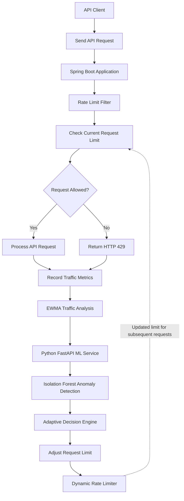

# AI-Driven Adaptive API Rate Limiter

**Final Year Project | B.Tech Computer Science and Engineering**

An anomaly-aware API rate-limiting system that combines traffic monitoring, EWMA-based trend analysis, and machine-learning-based anomaly assessment to support adaptive request-limit decisions.

---

## 1. Project Overview

Conventional API rate limiters enforce predefined request limits over a specified time window. Although fixed limits protect APIs against excessive requests, they may not respond appropriately to changing traffic patterns, sudden traffic bursts, or potentially anomalous request behaviour.

This project implements an adaptive API rate-limiting prototype that combines:

- Spring Boot for API request handling and rate-limit enforcement.
- Exponentially Weighted Moving Average (EWMA) for traffic trend analysis.
- Python FastAPI and Isolation Forest for anomaly assessment.
- An adaptive decision engine for bounded runtime limit adjustment.
- A dynamic rate limiter for enforcing updated request limits.

The project investigates the trade-off between protecting API availability and avoiding unnecessary rejection of legitimate traffic.

## 2. Research Focus

**Research Question:**

Can combining traffic trend analysis and machine-learning-based anomaly assessment with bounded adaptive rate-limit decisions provide a useful alternative to conventional fixed-window rate limiting under controlled API traffic scenarios?

The project does not claim to invent adaptive rate limiting or the Isolation Forest algorithm. Its focus is the implementation and experimental evaluation of an integrated approach.

## 3. System Architecture

The system follows a simple request-processing and adaptive-monitoring workflow.

### 3.1 Architecture Diagram



### 3.2 Working of the Architecture

1. **API Client:** Sends an HTTP request to the application.
2. **Spring Boot Application:** Receives the request and forwards it to the rate-limit filter.
3. **Rate Limit Filter:** Identifies the client and checks the current request limit.
4. **Request Decision:** If the request is within the limit, it is processed. Otherwise, the application returns HTTP 429 (Too Many Requests).
5. **Traffic Monitoring:** Records incoming request statistics and traffic behaviour.
6. **EWMA Analysis:** Calculates a smoothed traffic trend to identify changes in request volume.
7. **Python ML Service:** Receives traffic features and performs anomaly assessment.
8. **Isolation Forest:** Identifies potentially unusual traffic patterns.
9. **Adaptive Decision Engine:** Evaluates traffic trends and anomaly assessment to decide whether the current request limit should change.
10. **Dynamic Rate Limiter:** Applies the updated limit to subsequent incoming requests.

**Note:** Traffic monitoring and adaptive evaluation run separately from the immediate request-processing path. The updated limit affects subsequent requests, not the request that has already been processed.

## 4. Project Objectives

- Protect APIs against excessive request traffic.
- Enforce configurable request limits.
- Collect request metrics, including total, allowed and rejected requests.
- Analyse traffic trends using EWMA.
- Detect potentially anomalous traffic using Isolation Forest.
- Integrate traffic monitoring and anomaly assessment into an adaptive decision engine.
- Adjust request limits within predefined safety boundaries.
- Compare static and adaptive rate-limiting approaches through controlled experiments.

## 5. Technology Stack

| Layer | Technology |
|---|---|
| Backend | Java 17, Spring Boot 3.5.x |
| Build Tool | Maven |
| Rate Limiting | Fixed-window and dynamic rate limiter |
| Traffic Monitoring | Spring Boot monitoring components |
| Trend Analysis | EWMA |
| Machine Learning | Isolation Forest |
| ML API | Python, FastAPI, Pydantic |
| Testing | JUnit, Spring Boot Test, pytest |
| Shared State | Redis — Planned |
| Frontend | React — Planned |

## 6. Implementation Status

| Phase | Component | Current Status |
|---|---|---|
| Phase 1 | Spring Boot static rate limiter | Implemented |
| Phase 2 | Redis integration | Pending |
| Phase 3 | Traffic monitoring and EWMA | Implemented |
| Phase 4 | Python FastAPI Isolation Forest service | Implemented independently |
| Phase 5 | Adaptive decision engine and integration | Implemented; live ML validation pending |
| Phase 6 | React monitoring dashboard | Pending |
| Phase 7 | End-to-end experiments and comparative evaluation | Pending |

**Note:** Update this table only after verifying the relevant source code and tests.

## 7. Key Features

### Implemented

- Static fixed-window API rate limiting.
- Configurable request limits and observation windows.
- HTTP 429 responses when the request quota is exceeded.
- Rate-limit response headers.
- Client-based request counting.
- Traffic metrics collection.
- EWMA-based traffic trend analysis.
- Python FastAPI anomaly detection service.
- Isolation Forest-based anomaly assessment.
- Adaptive decision engine with bounded limit adjustments.
- Scheduled adaptive evaluation.
- Conservative fallback when anomaly assessment is unavailable.
- Automated backend and ML service tests.

### Planned or In Progress

- Redis-backed distributed rate-limit state.
- React monitoring dashboard.
- Live end-to-end validation against the running Python ML service.
- Further controlled performance comparison of static and adaptive approaches.

## 8. Adaptive Decision Mechanism

The adaptive decision engine evaluates traffic conditions and anomaly assessments before recommending a change to the current request limit.

The implemented decision behaviour includes:

- Traffic spikes may trigger a reduction in the current request limit.
- Sustained traffic growth is evaluated before making an adjustment.
- Anomalous traffic can trigger a conservative reduction.
- Normal traffic conditions support gradual recovery.
- Cooldown periods prevent excessively frequent limit changes.
- Minimum and maximum bounds prevent unsafe limit adjustments.

The current implementation uses a global adaptive limit rather than a separately maintained adaptive limit for each client. This is an identified limitation.

## 9. Machine Learning Component

The Python FastAPI service provides anomaly assessment through an Isolation Forest model.

### Main Responsibilities

- Accept traffic-related feature values.
- Validate incoming request data.
- Perform anomaly assessment.
- Return the assessment through an API response.
- Expose service health and model information.

### ML Service API Endpoints

| Method | Endpoint | Purpose |
|---|---|---|
| GET | `/health` | Check ML service health |
| GET | `/model/info` | Retrieve model information |
| POST | `/detect` | Perform anomaly assessment |
| GET | `/docs` | Interactive API documentation |

**Model limitation:** The current model uses synthetic training data. Real-world anomaly detection performance has not yet been established.

## 10. Backend API Endpoints

### Spring Boot Backend

| Method | Endpoint | Purpose |
|---|---|---|
| GET | `/api/health` | Backend health check |
| GET | `/api/demo` | Protected demonstration endpoint |
| GET | `/api/metrics` | Retrieve traffic monitoring metrics |
| GET | `/api/adaptive/status` | Retrieve adaptive system status |

### Python FastAPI Service

| Method | Endpoint | Purpose |
|---|---|---|
| GET | `/health` | ML service health |
| GET | `/model/info` | Model information |
| POST | `/detect` | Anomaly detection |
| GET | `/docs` | API documentation |

Check the current controller and schema files for the exact request and response formats.

## 11. Repository Structure

```text
adaptive-rate-limiter/
│
├── src/
│   ├── main/
│   │   ├── java/com/example/ratelimiter/
│   │   │   ├── adaptive/
│   │   │   ├── config/
│   │   │   ├── controller/
│   │   │   ├── filter/
│   │   │   ├── monitoring/
│   │   │   └── ratelimit/
│   │   │
│   │   └── resources/
│   │
│   └── test/
│
├── ml-service/
│   ├── app/
│   │   ├── config.py
│   │   ├── detector.py
│   │   ├── main.py
│   │   └── schemas.py
│   │
│   ├── tests/
│   ├── requirements.txt
│   └── README.md
│
├── pom.xml
├── mvnw
├── mvnw.cmd
└── README.md
```

This is a representative structure. Refer to the repository for the exact current file organisation.

## 12. Prerequisites

- Java Development Kit (JDK) 17 or compatible version.
- Python compatible with the ML service dependencies.
- Git.
- Internet connection for initial dependency installation.

Maven is available through the included Maven Wrapper.

## 13. Installation and Setup

### Step 1: Clone the Repository

```bash
git clone https://github.com/pragya638/adaptive-rate-limiter.git
cd adaptive-rate-limiter
```

### Step 2: Start Spring Boot Backend

On Windows:

```powershell
.\mvnw.cmd spring-boot:run
```

On Linux/macOS:

```bash
./mvnw spring-boot:run
```

Backend default URL:

`http://localhost:8080`

### Step 3: Start Python ML Service

Open another terminal:

```powershell
cd ml-service

python -m venv .venv

.\.venv\Scripts\Activate.ps1

python -m pip install -r requirements.txt

python -m uvicorn app.main:app --reload --port 8000
```

ML service default URL:

`http://localhost:8000`

Interactive API documentation:

`http://localhost:8000/docs`

## 14. Running Tests

### Spring Boot Tests

On Windows:

```powershell
.\mvnw.cmd clean test
```

### Python Tests

From the `ml-service` directory:

```powershell
python -m pytest
```

Run tests again after pulling changes. Report the actual test counts from the latest execution rather than relying on an older result.

## 15. Current Limitations

- Redis-backed distributed rate-limit state is not implemented.
- Adaptive limits and counters are process-local and in-memory.
- Adaptive limit changes are global rather than independently maintained per client.
- Live end-to-end validation against a running Python ML service remains pending.
- The Isolation Forest model uses synthetic training data.
- Real-world anomaly detection accuracy has not been established.
- Adaptive thresholds and step sizes require experimental tuning.
- The React monitoring dashboard is not yet implemented.
- Full-system performance comparison remains pending.

## 16. Research Evaluation Plan

The system will be evaluated using controlled traffic scenarios.

### Planned Traffic Scenarios

1. **Normal Traffic:** Regular API request patterns.
2. **Sudden Traffic Spike:** A rapid increase in request volume.
3. **Anomalous Traffic:** Unusual request behaviour.
4. **Recovery Phase:** Traffic returns to normal after an anomalous period.

### Evaluation Metrics

- Legitimate-request rejection rate.
- Anomaly detection precision.
- Anomaly detection recall.
- F1-score, where labelled data is available.
- False-positive rate.
- Throughput.
- p50 and p95 response latency.
- Detection time.
- Adaptation time.

Results will be reported only after the experiments have actually been executed.

## 17. Project Contribution

The intended contribution is an integrated prototype connecting:

1. Conventional API rate-limit enforcement.
2. Traffic trend analysis using EWMA.
3. Machine-learning-based anomaly assessment.
4. Bounded adaptive rate-limit decisions.
5. Controlled comparison against a static rate limiter.

The project also examines practical limitations such as false-positive restrictions, recovery behaviour, global adaptation and process-local state.

## 18. Future Work

- Integrate Redis for shared rate-limit state across backend instances.
- Investigate per-client adaptive limit management.
- Validate the complete Spring Boot and Python ML integration.
- Tune adaptive thresholds using controlled experiments.
- Develop a React monitoring dashboard.
- Perform reproducible static-versus-adaptive performance evaluation.
- Document experimental findings and limitations.

---

**Project:** AI-Driven Adaptive API Rate Limiter  
**Repository:** https://github.com/pragya638/adaptive-rate-limiter

**Academic Programme:** B.Tech Computer Science and Engineering  
**Academic Session:** 2026–2027  
**Institution:** Raj Kumar Goel Institute of Technology, Ghaziabad
