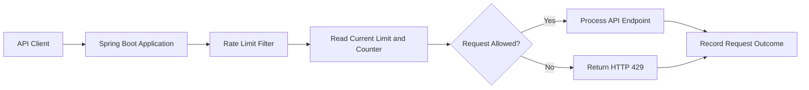

# AI-Driven Adaptive API Rate Limiter

**Final Year Project | B.Tech Computer Science and Engineering | Academic Session 2026–2027**

An adaptive API rate-limiting prototype that combines request enforcement, traffic monitoring, EWMA-based trend analysis, machine-learning-based anomaly assessment, and bounded adaptive limit decisions.

The project studies the trade-off between protecting API availability and avoiding unnecessary rejection of legitimate traffic. It is an implementation and evaluation project; it does not claim to invent rate limiting, EWMA, or Isolation Forest.

---

## 1. Project Overview

Conventional API rate limiters commonly enforce a predefined request quota within a time window. Fixed limits are useful for protecting services from excessive traffic, but they do not automatically respond to changing traffic conditions.

This project combines:

- **Java 17 and Spring Boot** for API request handling and rate-limit enforcement.
- **Fixed-window rate limiting** for the baseline request-control mechanism.
- **Traffic monitoring and EWMA** for observing and smoothing request-rate trends.
- **Python FastAPI** for exposing the machine-learning assessment service.
- **Isolation Forest** for identifying potentially unusual traffic patterns.
- **An adaptive decision engine** for making bounded runtime limit decisions.
- **A dynamic rate limiter** for applying updated limits to subsequent requests.
- **React** for the monitoring dashboard.
- **Redis** for shared rate-limit state and related distributed coordination.

The current implementation has both in-memory and Redis-backed capabilities. Their verification status and limitations are described below; they should not be treated as interchangeable deployment modes.

## 2. Research Focus

### Research Question

Can traffic trend analysis and machine-learning-based anomaly assessment, combined with bounded adaptive rate-limit decisions, provide a useful alternative to conventional fixed-window rate limiting under controlled API traffic scenarios?

### Project Scope

The project focuses on integrating and evaluating:

1. API rate-limit enforcement.
2. EWMA-based traffic trend analysis.
3. Isolation Forest anomaly assessment.
4. Bounded adaptive decisions.
5. Static-versus-adaptive behaviour under controlled traffic scenarios.

The project also examines false positives, legitimate-request rejection, recovery behaviour, global adaptation, and storage behaviour.

## 3. System Architecture

The application has two connected workflows: immediate request processing and background monitoring/adaptation.

### 3.1 Request-Processing Flow



### 3.2 Monitoring and Adaptive-Decision Flow

```mermaid
flowchart LR
    A["Traffic Metrics"] --> B["Monitoring Windows"]
    B --> C["EWMA Trend Analysis"]
    C --> D["Metrics-to-Features Mapping"]
    D --> E["Python FastAPI"]
    E --> F["Isolation Forest Assessment"]
    F --> G["Adaptive Decision Engine"]
    G --> H["Adaptive Limit Advisor"]
    H --> I["Dynamic Rate Limiter"]
    I -.->|"Updated limit for subsequent requests"| J["Request Limit Check"]
```



### 3.3 Dashboard Flow

The React dashboard is a presentation and monitoring layer. It consumes backend REST APIs and displays the state reported by the backend.

It does not independently calculate the backend's EWMA values, perform the Isolation Forest assessment, or enforce request limits.

### 3.4 Important Execution Detail

Request filtering is performed on the request path. Monitoring and adaptive evaluation run separately through the monitoring/scheduling workflow.

A newly applied limit affects subsequent requests; it does not retroactively change a request that has already been processed.

## 4. How the System Works

1. An API client sends a request to the Spring Boot application.
2. The rate-limit filter identifies the client and checks the active limit and counter.
3. An allowed request proceeds to the API endpoint. A rejected request receives HTTP `429 Too Many Requests`.
4. Request outcomes and traffic metrics are recorded.
5. Monitoring windows and EWMA provide traffic-trend information.
6. The Java feature mapper prepares traffic features for the ML service.
7. Spring Boot communicates with the Python FastAPI service.
8. Isolation Forest returns an anomaly assessment.
9. The adaptive decision engine evaluates the available trend and anomaly information using decision rules and configured bounds.
10. The adaptive limit advisor proposes a new limit, and the dynamic limiter applies it for subsequent requests.
11. The dashboard reads backend-reported metrics, history, decisions, and system status.

**Important:** An anomaly assessment does not automatically mean that traffic is malicious. A legitimate traffic surge can also look unusual to an anomaly-detection model.

## 5. Technology Stack

| Layer | Technology |
|---|---|
| Backend | Java 17, Spring Boot 3.5.x |
| Build Tool | Maven |
| Baseline Rate Limiter | Fixed-window rate limiter |
| Adaptive Enforcement | Adaptive decision engine and dynamic rate limiter |
| Traffic Monitoring | Spring Boot monitoring components |
| Trend Analysis | Exponentially Weighted Moving Average (EWMA) |
| ML Service | Python, FastAPI, Pydantic |
| Anomaly Detection | Isolation Forest |
| Shared State / Coordination | Redis |
| Frontend | React, TypeScript, Vite |
| Backend Testing | JUnit, Spring Boot Test |
| ML Testing | pytest |
| Frontend Testing | Frontend test suite, TypeScript typecheck, production build |

## 6. Current Implementation Status

This status reflects the latest implementation and verification reports supplied for the project. Test counts are tied to their specific verification phase; they should not be combined into a single test-run claim.

| Area | Current Status | Evidence / Qualification |
|---|---|---|
| Spring Boot request handling and static rate limiter | Implemented and exercised | Live HTTP 200/429 request tests |
| Traffic monitoring and EWMA | Implemented and checked | 119 consecutive history pairs checked; maximum recurrence error approximately 1.11 × 10⁻¹⁶ |
| Python FastAPI ML service | Implemented and exercised | Health, model information and detection endpoints checked |
| Isolation Forest assessment | Integrated and exercised | Backend feature vector assessment matched its corresponding backend history record |
| Adaptive decision engine and dynamic limit updates | Implemented and exercised | Live decision history and limit changes observed |
| React dashboard | Implemented | Six dashboard pages checked in browser automation |
| Dashboard history | Implemented using bounded in-memory backend storage | Available across browser refreshes while backend runs; resets on backend restart |
| Redis-backed counter/state components | Implemented and locally tested | 26 focused local Redis tests passed |
| Docker/Testcontainers Redis verification | Not completed | Docker-based integration tests were skipped |
| Complete distributed multi-instance demonstration | Not demonstrated in the latest run | Do not claim a live distributed deployment |
| Comparative evaluation | Evaluation framework exists; final re-run required | Re-run after final integration/configuration changes |

## 7. Implemented Features

### 7.1 API Rate Limiting

- Static fixed-window request limiting.
- Configurable request limit and observation window.
- Client identification and request counting.
- HTTP `429` responses when the quota is exhausted.
- Rate-limit response headers.
- Dynamic limit application for subsequent requests.

### 7.2 Traffic Monitoring and EWMA

- Request, allowed, rejected, and traffic metrics.
- Monitoring-window history.
- EWMA-based traffic trend calculation.
- Backend-reported EWMA values displayed in the dashboard.
- History and metrics APIs used by the frontend.

The EWMA recurrence used for verification is:

\[
EWMA_t = \alpha X_t + (1-\alpha)EWMA_{t-1}
\]

Where:

- \(X_t\) = Current observation.
- \(\alpha\) = Smoothing factor.
- \(EWMA_{t-1}\) = Previous EWMA value.

EWMA gives greater importance to recent observations while retaining information from previous observations.

### 7.3 Machine-Learning Service

- Python FastAPI service.
- Request-schema validation.
- Isolation Forest anomaly assessment.
- Health and model-information endpoints.
- ML availability and evaluation-status reporting through the backend.

**Model limitation:** The current model was trained using synthetic data. Its real-world anomaly-detection accuracy has not been established.

### 7.4 Adaptive Decisions

- Scheduled traffic evaluation.
- Metrics-to-features mapping.
- Java-to-Python ML service communication.
- Adaptive decision rules.
- Bounded limit adjustment.
- Decision history and explanations where available.
- Conservative handling when ML assessment is unavailable.
- Runtime system-status reporting.

The current adaptive limit is global rather than independently maintained for every client. This is a known design limitation.

### 7.5 React Monitoring Dashboard

The unified dashboard contains six pages:

| Page | Main Information |
|---|---|
| Overview | Current limit, request metrics, traffic chart and recent history |
| Rate Limiting | Static/adaptive views, request tester and limit timeline |
| Traffic Monitoring | Traffic metrics, request/EWMA trends and monitoring-window history |
| Anomaly Detection | Latest ML assessment, anomaly history, model information and feature values |
| Adaptive Decisions | Decision history, limit timeline and decision/anomaly co-occurrence |
| System Status | Backend/API connectivity, storage state, scheduler status and ML availability |

The dashboard also supports:

- Time-range filtering.
- CSV exports.
- Empty-history states.
- Stale-data messaging.
- Backend-unavailable states.

The frontend uses actual backend responses rather than fabricated history data.

## 8. Adaptive Decision Mechanism

The adaptive decision engine combines traffic information and anomaly assessment with bounded decision rules.

The implementation supports decision outcomes such as:

- `INCREASE_LIMIT`
- `DECREASE_LIMIT`
- `KEEP_LIMIT`

Traffic spikes or unusual conditions may result in a conservative reduction. Normal conditions can support recovery, subject to configured bounds and cooldown behaviour.

A decision is not proof that a traffic pattern is malicious. Decision/anomaly correlation in the dashboard represents co-occurrence across retained records, not proven causation.

## 9. Machine-Learning Component

The Python service exposes an Isolation Forest model through FastAPI.

### Traffic Features

The latest backend feature vector reports these four features:

- `request_rate`
- `error_rate`
- `burst_ratio`
- `request_count`

### ML Service Endpoints

| Method | Endpoint | Purpose |
|---|---|---|
| GET | `/health` | Check ML service health |
| GET | `/model/info` | Retrieve model metadata |
| POST | `/detect` | Perform anomaly assessment |
| GET | `/docs` | Interactive API documentation |

The verification report recorded a model configuration of 200 estimators and 2,000 samples. These are reported model details, not a claim of real-world accuracy.

## 10. Backend API Endpoints

The following Spring Boot endpoints were identified as consumed by the dashboard or checked during verification.

### Spring Boot Backend

| Method | Endpoint | Purpose |
|---|---|---|
| GET | `/api/health` | Backend health |
| GET | `/api/demo` | Demonstration endpoint used by the request tester |
| GET | `/api/metrics` | Traffic metrics |
| GET | `/api/adaptive/status` | Adaptive system status |
| GET | `/api/system-status` | Backend, storage, monitoring and ML status |
| GET | `/api/history` | Retained dashboard history |

### Python FastAPI Service

| Method | Endpoint | Purpose |
|---|---|---|
| GET | `/health` | ML service health |
| GET | `/model/info` | Model information |
| POST | `/detect` | Anomaly assessment |
| GET | `/docs` | Interactive API documentation |

Check the current controller and DTO files for exact request/response fields. Do not assume undocumented endpoints or response schemas.

## 11. Verification Results

### 11.1 Live Services

The latest live verification reported all three services responding successfully:

| Service | Port | Result |
|---|---:|---|
| Spring Boot Backend | 8080 | HTTP 200 |
| React/Vite Frontend | 5173 | HTTP 200 |
| Python ML Service | 8000 | HTTP 200 |

### 11.2 Request-Limiter Checks

- Five requests at an active limit of five returned HTTP 200.
- Requests exceeding the limit returned HTTP 429.
- `Retry-After` and rate-limit headers were checked.
- A second run at an adaptive limit of four produced four allowed requests and two rejected requests.
- A request-tester run observed an adaptive limit change while the run was in progress.

These are observations from the reported verification run, not universal performance guarantees.

### 11.3 EWMA and ML Checks

- 119 consecutive EWMA history pairs were checked with α = 0.3.
- Maximum recurrence error was approximately `1.11 × 10⁻¹⁶`.
- The backend's latest feature vector was submitted to the ML detection endpoint.
- The returned score matched the corresponding backend history assessment for that window.
- Normal and extreme direct test inputs produced different assessments.
- Invalid ML payload handling was checked.

### 11.4 Dashboard and Export Checks

- All six dashboard pages were opened through browser automation.
- Traffic, anomaly, decision, and correlation CSV exports were downloaded.
- The reported CSV files contained a UTF-8 BOM, expected headers, and 120 data rows each.
- Empty history after backend restart was displayed without fabricated records.
- Backend-offline and stale-data states were exercised.
- The dashboard recovered after the backend restarted.

### 11.5 Test Results

| Test Group | Reported Result | Scope |
|---|---|---|
| Backend Phase 4A suite | 177 passed, 0 failed, 0 errors, 10 skipped | Earlier completed run; skipped tests were environment-dependent Redis/Testcontainers tests |
| Focused local Redis tests | 26 passed, 0 failed, 0 errors, 0 skipped | Later local Redis test run |
| Frontend automated tests | 23 passed | Frontend suite |
| Frontend TypeScript typecheck | Passed | Frontend |
| Frontend production build | Passed | Frontend |
| Python ML service tests | 76 passed | Earlier ML service run |

**Testing Qualification:** The complete Java, Python, and evaluation suites were not all rerun in the latest Phase 4B verification. The earlier results above are retained as earlier-run evidence and must not be represented as one simultaneous test execution.

## 12. Redis and Storage Status

Redis was available locally at `127.0.0.1:6380` during the focused Redis verification and responded to `PING`.

The focused Redis suite reported 26 passing tests covering:

- Counter store.
- Adaptive limit store.
- Leader lock.
- Multi-instance limiter classes.

However:

- Docker was unavailable, so Docker-based Testcontainers tests were skipped.
- The latest run did not demonstrate a complete live distributed deployment with multiple backend instances.
- The dashboard's `/api/history` records are bounded in-memory backend history, not durable Redis-backed history.
- Dashboard history survives browser refresh while the backend is running, but resets when the backend restarts.

**Important:** Do not describe dashboard history as Redis-persistent.

## 13. Known Limitations

1. The Isolation Forest model uses synthetic training data; real-world accuracy is not established.
2. Adaptive limit changes are global, not independently maintained per client.
3. Dashboard history is bounded in-memory and resets on backend restart.
4. Docker/Testcontainers Redis integration was not verified in the latest run.
5. A complete live multi-instance distributed deployment was not demonstrated.
6. Time-range filtering controls and filtered CSV generation were checked, but actual row exclusion could not be demonstrated because the retained history span was shorter than the minimum five-minute filter.
7. When the backend is stopped, the Vite development proxy can return HTTP 500, producing a less precise error message than a network-unreachable response.
8. Full Java, Python, and evaluation suites were not all rerun during the latest Phase 4B verification.
9. Adaptive thresholds and step sizes require further experimental tuning.
10. Decision/anomaly co-occurrence does not establish causation.

## 14. Running the Project Locally

### Prerequisites

- JDK 17.
- Python version compatible with `ml-service/requirements.txt`.
- Node.js and npm for the React frontend.
- Git.
- Redis only when running the Redis-backed configuration.

### 14.1 Start the Spring Boot Backend

From the repository root, on Windows:

```powershell
.\mvnw.cmd spring-boot:run
```

On Linux/macOS:

```bash
./mvnw spring-boot:run
```

Default backend URL:

`http://localhost:8080`

### 14.2 Start the Python ML Service

Open another terminal:

```powershell
cd ml-service
python -m venv .venv
.\.venv\Scripts\Activate.ps1
python -m pip install -r requirements.txt
python -m uvicorn app.main:app --reload --port 8000
```

On Linux/macOS, activate the environment with:

```bash
source .venv/bin/activate
```

ML service URL:

`http://localhost:8000`

Interactive API documentation:

`http://localhost:8000/docs`

### 14.3 Start the React Dashboard

Open another terminal:

```bash
cd frontend
npm install
npm run dev
```

The Vite development server commonly uses:

`http://localhost:5173`

Use the port printed by Vite if it selects a different one. The frontend expects the backend APIs to be available through its configured API client/proxy.

### 14.4 Redis

For Redis-backed operation, start a Redis server and use the Redis connection settings configured by the application.

The local verification report used `127.0.0.1:6380`; this is not necessarily the default port for every environment.

Check the active application configuration before running. Do not assume that starting Redis automatically switches the application from memory mode to Redis mode.

## 15. Running Tests

### Spring Boot Backend

Windows:

```powershell
.\mvnw.cmd test
```

Linux/macOS:

```bash
./mvnw test
```

### Python ML Service

From `ml-service`:

```bash
python -m pytest
```

### React Frontend

From `frontend`:

```bash
npm test
npm run typecheck
npm run build
```

Use the scripts actually defined in `frontend/package.json`; if a script name differs, follow that file.

Record the output and environment for each test run. Redis/Testcontainers tests may require Docker or a valid Redis test environment.

## 16. Research Evaluation Plan

The project should compare static and adaptive rate limiting under repeatable traffic scenarios.

### Traffic Scenarios

1. **Normal Traffic:** Regular request patterns.
2. **Sudden Traffic Spike:** Rapid increase in request volume.
3. **Error-Heavy Traffic:** Increased error rate.
4. **Recovery Phase:** Traffic returns towards normal after a burst or unusual period.

### Evaluation Metrics

- Legitimate-request rejection rate.
- Anomaly detection precision, recall, and F1-score where labelled data is available.
- False-positive rate.
- Throughput.
- p50 and p95 response latency.
- Detection time.
- Adaptation time.
- Recovery behaviour.

Report measured results, test configuration, sample sizes, and limitations.

Do not claim adaptive mode is superior unless the results support that conclusion. In particular, a lower request limit can reject legitimate traffic as well as anomalous traffic.

## 17. Project Contribution

The project's contribution is an integrated prototype and controlled evaluation of:

1. Conventional API rate-limit enforcement.
2. EWMA-based traffic trend analysis.
3. Isolation Forest anomaly assessment.
4. Bounded adaptive rate-limit decisions.
5. Dashboard visibility into traffic, anomaly assessments, and decisions.
6. Comparison of static and adaptive behaviour under controlled scenarios.

The project also documents practical limitations such as false positives, legitimate-request rejection, recovery behaviour, global adaptation, and process-local history.

## 18. Future Work

- Complete Docker/Testcontainers Redis verification.
- Demonstrate shared rate-limit state across multiple running backend instances.
- Consider per-client adaptive limit management.
- Improve the backend-unavailable error presentation.
- Expand retained history or use a suitable test configuration to verify longer time-range row exclusion.
- Re-run complete Java, Python, and evaluation suites after final integration changes.
- Tune thresholds using repeatable experiments.
- Evaluate real-world or better-labelled traffic data.
- Publish reproducible static-versus-adaptive evaluation results.

## 19. Project Information

**Project Title:** AI-Driven Adaptive API Rate Limiter

**Repository:** https://github.com/pragya638/adaptive-rate-limiter

**Academic Programme:** B.Tech Computer Science and Engineering

**Academic Session:** 2026–2027

**Institution:** Raj Kumar Goel Institute of Technology, Ghaziabad

---

*This README reflects the implementation and verification evidence available at the time of its latest update. Update status and test counts when new code changes or verification runs are completed.*
