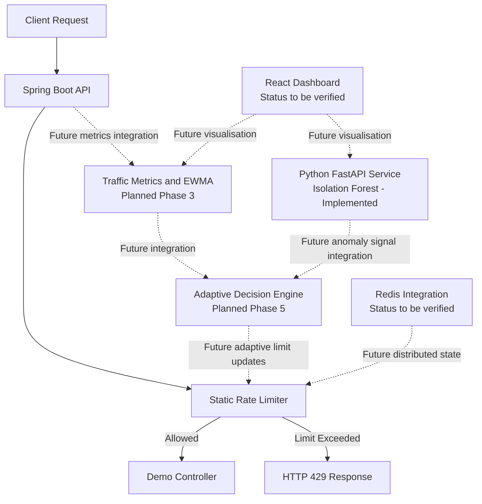

# Adaptive API Rate Limiter Using Traffic Trend Analysis and Anomaly Detection

**Final Year Project (FYP)**

An intelligent API rate-limiting system designed to combine request throttling, traffic trend analysis, and machine-learning-based anomaly detection. The long-term goal is to adjust API rate limits dynamically while maintaining configurable safety bounds.

**Current implementation:** The repository contains a working Spring Boot static rate limiter and a standalone Python FastAPI Isolation Forest service. The complete adaptive system is still under development.

## Table of Contents

- [Problem Statement](#problem-statement)
- [Project Objectives](#project-objectives)
- [Key Features](#key-features)
- [Technology Stack](#technology-stack)
- [System Architecture](#system-architecture)
- [Implementation Status](#implementation-status)
- [Phase 1: Static Rate Limiter](#phase-1-static-rate-limiter)
- [Phase 4: Isolation Forest Service](#phase-4-isolation-forest-service)
- [Prerequisites](#prerequisites)
- [Project Structure](#project-structure)
- [Running the Spring Boot Application](#running-the-spring-boot-application)
- [Running the Python ML Service](#running-the-python-ml-service)
- [Running Tests](#running-tests)
- [API Reference](#api-reference)
- [Limitations](#limitations)
- [Future Work](#future-work)
- [References](#references)

## Problem Statement

Traditional static API rate limiters enforce a fixed request quota, regardless of changes in traffic patterns. This can restrict legitimate traffic during sudden increases in demand or fail to respond appropriately to unusual request bursts.

This project aims to develop an adaptive rate-limiting system that combines traffic monitoring, trend analysis, and anomaly detection to support more context-aware rate-limit decisions.

The proposed system will use a Java Spring Boot backend, a Python machine-learning service, and a future adaptive decision engine. Redis and a React dashboard are planned components.

## Project Objectives

- Implement a configurable, per-client static API rate limiter.
- Collect traffic metrics and analyse request-rate trends using Exponentially Weighted Moving Average (EWMA).
- Detect unusual traffic patterns using the Isolation Forest algorithm.
- Develop an adaptive decision engine that adjusts limits within configured safety bounds.
- Build a dashboard to visualise request traffic, rate-limit decisions, and detected anomalies.
- Compare static and adaptive rate limiting under controlled traffic conditions.

## Key Features

- Fixed-window API rate limiting with configurable quotas.
- Per-client request tracking using a client identifier or IP fallback.
- HTTP 429 responses when the request limit is exceeded.
- Rate-limit headers and `Retry-After` information.
- Standalone FastAPI service for Isolation Forest anomaly detection.
- Input validation, including rejection of invalid and non-finite numeric values.
- Automated tests for the implemented backend and machine-learning service.
- Modular architecture designed for future integration.

## Technology Stack

| Component | Technology |
|---|---|
| Backend | Java 17, Spring Boot 3.5.x |
| Rate-limiting algorithm | Java, fixed-window counter |
| ML service | Python, FastAPI, Uvicorn |
| Anomaly detection | scikit-learn, Isolation Forest |
| Numerical processing | NumPy |
| Python API validation | Pydantic |
| Backend testing | JUnit, Spring test tools |
| ML service testing | pytest, HTTPX |
| Build tools | Maven Wrapper, pip, Python virtual environments |
| Distributed state | Redis — planned or pending verification |
| Frontend | React — planned or pending verification |

Refer to `ml-service/requirements.txt` for the exact Python dependency versions used by the implementation.

## System Architecture

The following diagram distinguishes existing components from the planned adaptive workflow.



**Important:** The Spring Boot rate limiter and Python anomaly-detection service currently operate independently. The complete traffic-monitoring pipeline, adaptive decision engine, and automatic adjustment of rate limits must not be considered implemented until their integration is completed and tested.

## Implementation Status

| Component | Status | Details |
|---|---|---|
| Phase 1: Static rate limiter | Completed and tested | Spring Boot fixed-window rate limiter |
| Phase 2: Redis integration | Pending verification | Confirm the latest implementation and tests |
| Phase 3: Traffic monitoring and EWMA | Pending | Traffic trend analysis |
| Phase 4: Isolation Forest service | Implemented, tested and merged into `master` | Python FastAPI service |
| Phase 5: Adaptive decision engine | Pending | Dynamic rate-limit decisions |
| React dashboard | Pending verification | Dashboard implementation and API integration |
| End-to-end integration | Pending | Connect the backend, metrics, and ML service |
| Comparative evaluation | Pending | Controlled static-versus-adaptive experiments |

The Phase 4 verification report recorded **68 passing tests and one Starlette deprecation warning**. These are previously reported results, not a guarantee that the tests have been rerun on every machine.

## Phase 1: Static Rate Limiter

### Overview

The first phase implements a configurable static rate limiter using Java 17 and Spring Boot 3.5.x.

Implemented endpoints:

- `GET /api/health` — health-check endpoint excluded from rate limiting.
- `GET /api/demo` — sample protected endpoint.

The rate limiter uses a fixed-window counter to track requests per client. When a client exceeds its configured quota, the server returns HTTP `429 Too Many Requests` with a `Retry-After` header.

### How it works

1. The filter intercepts requests matching the configured rate-limited paths.
2. The client is identified using the configured client-ID header, with an IP fallback.
3. The rate limiter checks the client's request count for the current window.
4. Requests within the limit are allowed.
5. Requests exceeding the limit receive HTTP 429.

Successful requests include rate-limit headers such as `X-RateLimit-Limit` and `X-RateLimit-Remaining`.

The rate-limiting algorithm is separated from the controllers, allowing future implementations to replace the static algorithm without rewriting the endpoint logic.

### Configuration

The configuration is stored in `src/main/resources/application.yml`.

```yaml
rate-limit:
  enabled: true
  max-requests: 5
  window: 30s
  include-paths:
    - /api/**
  exclude-paths:
    - /api/health
  client-id-header: X-Client-Id
```

The example permits five requests per client during a 30-second window. Actual behaviour depends on the application's active configuration.

### Run the backend

From the repository root, open a terminal.

Windows PowerShell:

```powershell
java -version
.\mvnw.cmd spring-boot:run
```

macOS/Linux:

```bash
java -version
./mvnw spring-boot:run
```

The API starts at:

`http://localhost:8080`

### Test the endpoints

Check the health endpoint:

```powershell
curl.exe http://localhost:8080/api/health
```

Send a request to the protected endpoint:

```powershell
curl.exe -i -H "X-Client-Id: demo-user" http://localhost:8080/api/demo
```

To send multiple requests in Windows PowerShell:

```powershell
1..7 | ForEach-Object {
    curl.exe -i -s `
      -H "X-Client-Id: demo-user" `
      http://localhost:8080/api/demo |
      Select-String "HTTP/|X-RateLimit|Retry-After"
}
```

With the example configuration of five requests per 30-second window, the first five requests should be allowed and subsequent requests within that window should be rejected. A request may be allowed again when the applicable window resets.

### Run backend tests

Windows PowerShell:

```powershell
.\mvnw.cmd test
```

macOS/Linux:

```bash
./mvnw test
```

Run the HTTP integration test class separately:

```powershell
.\mvnw.cmd test "-Dtest=RateLimitingHttpTest"
```

The existing tests cover the static limiter's quota behaviour, client isolation, window resets, health endpoint, and HTTP 429 responses.

### Build the executable JAR

Windows PowerShell:

```powershell
.\mvnw.cmd clean package
```

After a successful build, inspect the `target/` directory to find the generated JAR. Run it using the actual generated filename:

```powershell
java -jar target\<generated-jar-name>.jar
```

Replace `<generated-jar-name>.jar` with the filename produced by Maven.

## Phase 4: Isolation Forest Service

### Overview

The Python service is located in `ml-service/`. It uses FastAPI for HTTP endpoints and scikit-learn's Isolation Forest algorithm to identify unusual traffic feature patterns.

The service currently uses deterministic synthetic training data for development and testing. It does not yet receive live metrics automatically from Spring Boot.

### Traffic features

The detection API accepts four traffic features:

| Feature | Meaning |
|---|---|
| `request_rate` | Observed request rate over a defined interval |
| `error_rate` | Proportion of requests resulting in errors |
| `burst_ratio` | Current traffic rate relative to a defined baseline |
| `request_count` | Number of requests observed during the interval |

Feature calculations must use consistent time intervals and units. Zero-baseline handling is required when calculating burst ratios.

### API endpoints

| Method | Endpoint | Purpose |
|---|---|---|
| GET | `/health` | Check service health and model readiness |
| POST | `/detect` | Classify a traffic feature sample |
| GET | `/model/info` | Return model configuration and readiness information |
| GET | `/docs` | Interactive API documentation |
| GET | `/openapi.json` | OpenAPI schema |

The detection endpoint returns an anomaly prediction and score according to the implemented response schema. The score is not a calibrated probability.

Invalid numeric inputs, including NaN and Infinity, are rejected by validation.

### Run the Python service

Prerequisites: an installed Python version compatible with the dependencies specified in `ml-service/requirements.txt`.

Windows PowerShell:

```powershell
cd ml-service

python -m venv .venv
.\.venv\Scripts\Activate.ps1

python -m pip install -r requirements.txt
python -m uvicorn app.main:app --host 127.0.0.1 --port 8000
```

If the virtual environment already exists, reuse it rather than recreating it unnecessarily.

If PowerShell activation is restricted, invoke the virtual environment's Python executable directly:

```powershell
.\.venv\Scripts\python.exe -m pip install -r requirements.txt
.\.venv\Scripts\python.exe -m uvicorn app.main:app --host 127.0.0.1 --port 8000
```

macOS/Linux:

```bash
cd ml-service

python3 -m venv .venv
source .venv/bin/activate

python -m pip install -r requirements.txt
python -m uvicorn app.main:app --host 127.0.0.1 --port 8000
```

Open the interactive documentation at:

`http://127.0.0.1:8000/docs`

For detailed Python setup, implementation notes, and API usage, see [`ml-service/README.md`](ml-service/README.md).

### Run Python tests

Run these commands from the `ml-service/` directory.

Windows PowerShell:

```powershell
.\.venv\Scripts\python.exe -m pytest -v
```

macOS/Linux, with the virtual environment activated:

```bash
python -m pytest -v
```

To verify dependency consistency:

```powershell
python -m pip check
```

The test suite covers model behaviour, API endpoints, input validation, readiness checks, and error handling.

## Prerequisites

For the current implementations, you need:

- JDK 17 for the Spring Boot application.
- A Python version compatible with the pinned dependencies in `ml-service/requirements.txt`.
- Git.
- Internet access when dependencies must be downloaded.

A separate Maven installation is not required because the repository includes the Maven Wrapper.

## Project Structure

```text
adaptive-rate-limiter/
├── .mvn/
│   └── wrapper/
├── src/
│   ├── main/
│   │   ├── java/com/example/ratelimiter/
│   │   │   ├── config/
│   │   │   ├── controller/
│   │   │   ├── ratelimit/
│   │   │   └── AdaptiveRateLimiterApplication.java
│   │   └── resources/
│   │       └── application.yml
│   └── test/
│       └── java/com/example/ratelimiter/
├── ml-service/
│   ├── app/
│   ├── tests/
│   ├── requirements.txt
│   └── README.md
├── pom.xml
├── mvnw
├── mvnw.cmd
└── README.md
```

This is a high-level overview; consult the actual repository for the complete file tree.

## Service URLs

| Service | URL | Purpose |
|---|---|---|
| Spring Boot | `http://localhost:8080` | Static rate-limited API |
| Health endpoint | `http://localhost:8080/api/health` | Backend health check |
| Demo endpoint | `http://localhost:8080/api/demo` | Protected API example |
| Python ML service | `http://127.0.0.1:8000` | Anomaly detection |
| ML documentation | `http://127.0.0.1:8000/docs` | Interactive API documentation |

The two services must be started separately. Running one does not automatically start the other.

## Example API Calls

### Spring Boot

```powershell
curl.exe http://localhost:8080/api/health

curl.exe -i `
  -H "X-Client-Id: demo-user" `
  http://localhost:8080/api/demo
```

### Python ML service

Check health:

```powershell
curl.exe http://127.0.0.1:8000/health
```

Inspect model information:

```powershell
curl.exe http://127.0.0.1:8000/model/info
```

Submit a detection request:

```powershell
curl.exe -X POST http://127.0.0.1:8000/detect `
  -H "Content-Type: application/json" `
  -d "{\"request_rate\":20.0,\"error_rate\":0.02,\"burst_ratio\":1.0,\"request_count\":20}"
```

The response fields and exact classification depend on the implementation and fitted model. Refer to `/docs` for the authoritative request and response schemas.

## Limitations

- **Synthetic training data:** The current Isolation Forest model uses synthetic traffic samples. Performance on real production traffic has not been established.
- **No automatic integration:** The Spring Boot backend does not yet automatically send traffic metrics to the Python service.
- **No adaptive rate adjustment:** The anomaly prediction does not currently change the Spring Boot rate limit.
- **Distributed state:** Redis integration must be verified before claiming distributed rate limiting.
- **Incomplete monitoring pipeline:** EWMA-based traffic trend monitoring remains a separate implementation milestone until verified.
- **Evaluation:** Real-world precision, recall, F1 score, throughput improvements, and latency improvements must not be claimed without appropriate experiments.
- **Production readiness:** The complete adaptive system requires integration testing, controlled evaluation, and further validation.

## Future Work

1. **Phase 2 — Redis integration:** Introduce shared rate-limit state suitable for distributed deployments.
2. **Phase 3 — Traffic monitoring and EWMA:** Track request rates, errors, and traffic trends over defined intervals.
3. **Phase 5 — Adaptive decision engine:** Combine traffic trends and anomaly signals to adjust limits within configured safety bounds.
4. **React dashboard:** Visualise traffic metrics, anomalies, and rate-limit decisions.
5. **End-to-end integration:** Connect Spring Boot traffic metrics to the Python service using a documented JSON contract and safe failure handling.
6. **Comparative evaluation:** Compare static and adaptive approaches using controlled traffic workloads.
7. **Model evaluation:** Use suitable real or labelled data, where available, to measure detection precision, recall, and F1.
8. **Performance analysis:** Measure legitimate-request rejection rate, p50/p95 latency, throughput, detection time, and adaptation time.

## References

- [Spring Boot Documentation](https://docs.spring.io/spring-boot/docs/3.5.x/reference/html/)
- [FastAPI Documentation](https://fastapi.tiangolo.com/)
- [scikit-learn Isolation Forest Documentation](https://scikit-learn.org/stable/modules/generated/sklearn.ensemble.IsolationForest.html)
- [Python ML Service README](ml-service/README.md)
